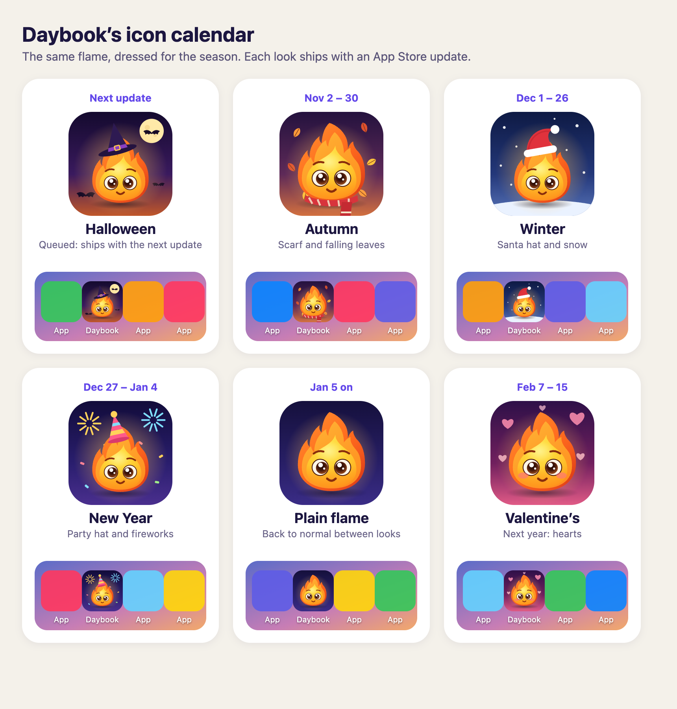

# The icon calendar

The owner, October 26, 2026: the app icon changes now and then, the way Duolingo dresses its owl. It is always the
same flame, clearly the same icon, in a look for a time of year. Each look ships as
the app's own icon in an App Store update, and the next update puts the plain flame back. The icon is never switched
from inside the app: iOS shows a "You have changed the icon" pop-up every time an app does that, it cannot happen while
the app is closed, and Apple has turned apps down for changing icons without being asked (research brief, October 26).

| When              | Look        | What it is                          |
| ----------------- | ----------- | ----------------------------------- |
| Oct 15 to Nov 1   | `halloween` | a witch's hat, a moon and bats      |
| Nov 2 to 30       | `autumn`    | a scarf and falling leaves          |
| Dec 1 to 26       | `winter`    | a red winter hat and snow           |
| Dec 27 to Jan 4   | `newyear`   | a party hat, fireworks and confetti |
| Jan 5 on          | plain       | the flame as it is, between looks   |
| Feb 7 to 15, 2027 | `valentine` | hearts and rosy cheeks              |

**Queued now (October 26):** the Halloween icon is in `apps/mobile/assets/images` and `apps/mobile/public`, so it ships
with the next App Store update (and the next web deploy). Nothing was built or submitted for it. If that update goes
out after November 1, run `npm run icons -- --look autumn` first instead. A melting flame was tried and dropped (it read
as weird).

## Shipping a look

The calendar is in code (core `flame-art.ts` `ICON_CALENDAR`), so the icon is switched by date before every App Store
build, without asking (the owner, October 26, 2026):

1. `npm run icons -- --auto` writes the icon for the day the update reaches people (the build day plus
   `ICON_LEAD_DAYS`, three days for review and updating): the look from the calendar, or the plain flame between looks.
   It prints which.
2. Say which icon the update carries in the commit and in the message to the owner, then build and submit as usual.

Only an App Store build changes the icon; an over-the-air update (`eas update`) cannot. `npm run icons -- --look
<look>` sets a look by hand.
