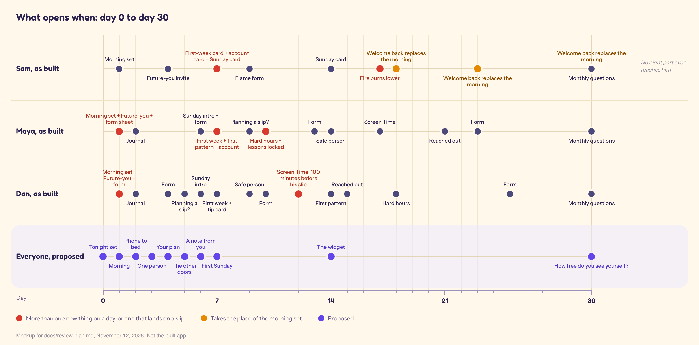
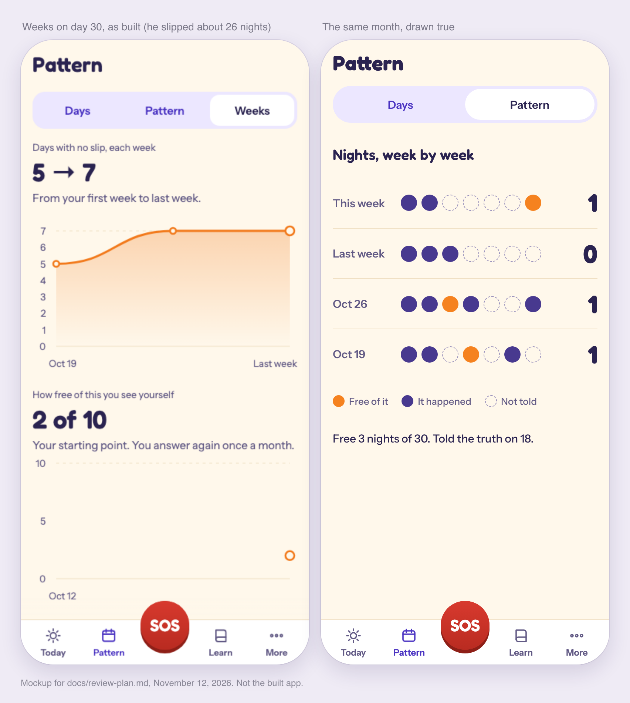
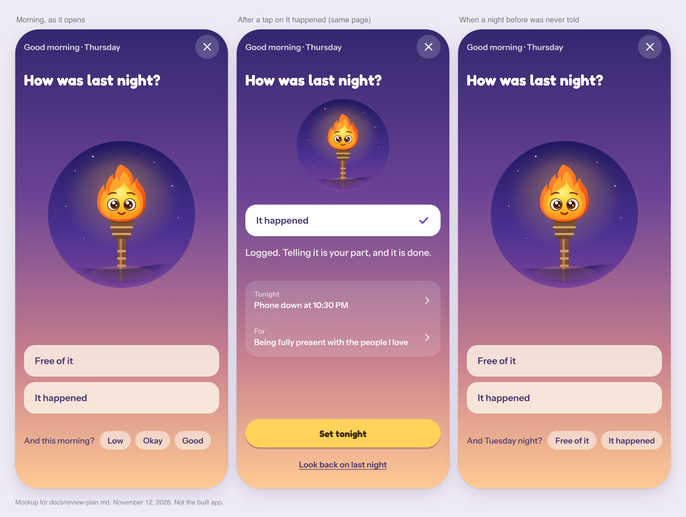
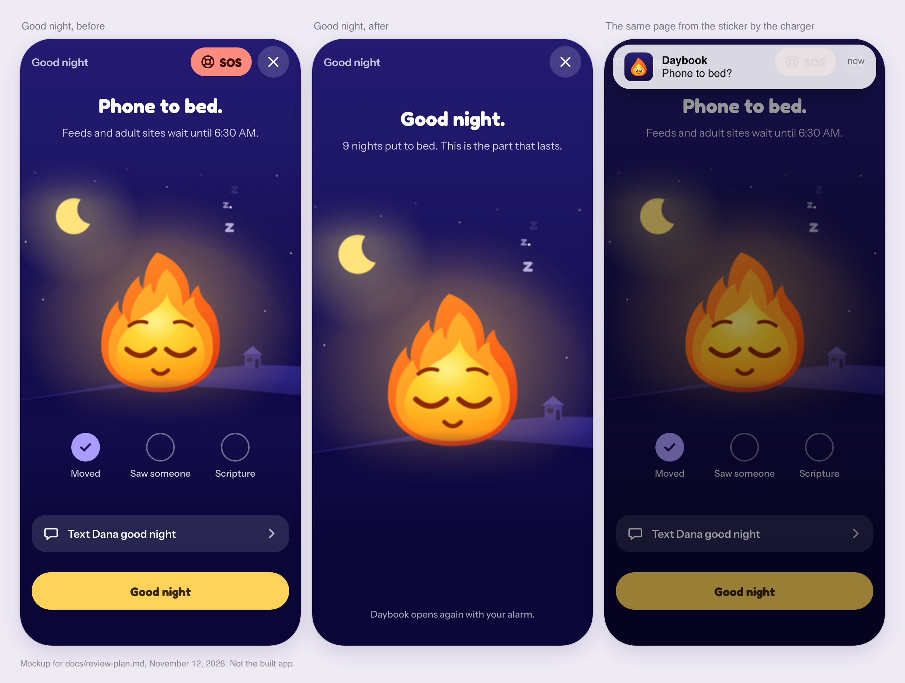
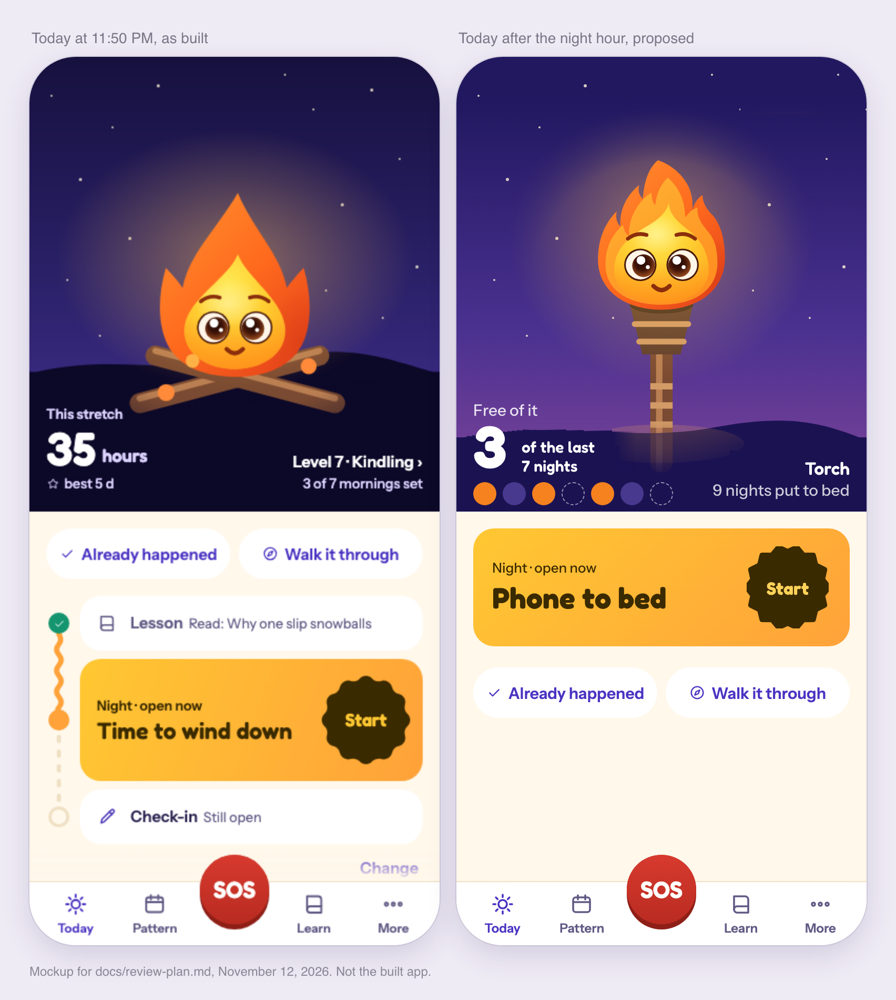
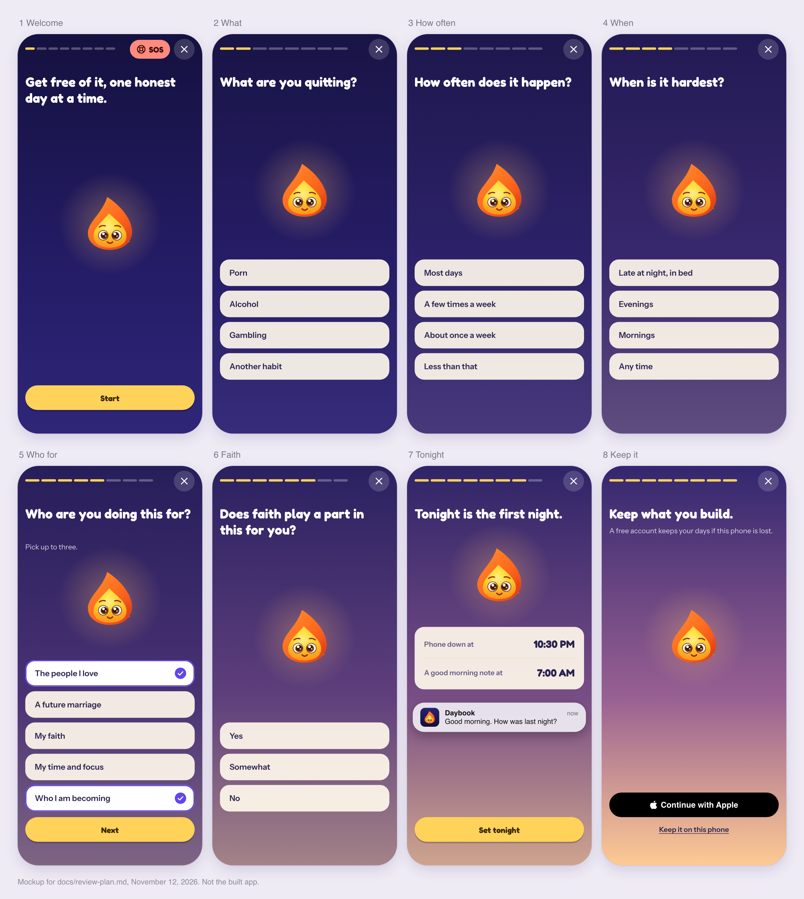
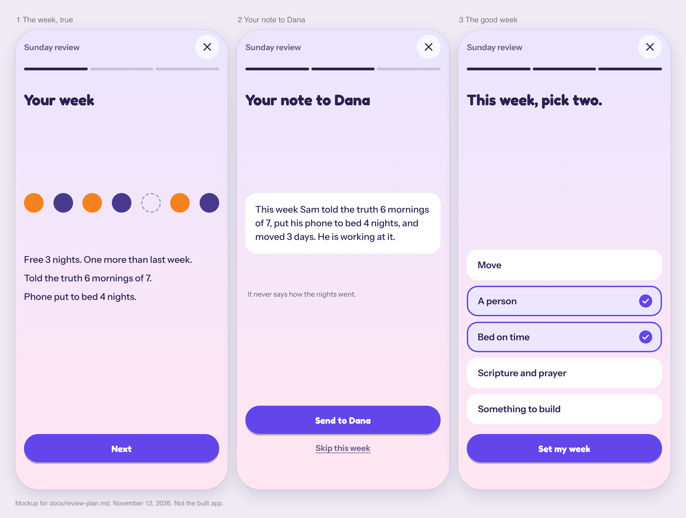

# Daybook: the whole-app review (November 12, 2026)

Written for the session that will start one session per work package (part 3), and for the owner, who decides part 4. Everything here
was judged by one question: does this help a person change from "I am an addict" to "I am someone who is free of this", at the moment
they are actually in? The one condition was that the app stays extremely simple.

**The verdict in five lines.**

1. The app is warm, well made and honest in its words, and it does not yet work for the person it was built by: the one who loses late at
   night with the app closed.
2. Its record of that person is false, and it rewards the falsehood. This is the worst problem, and nobody had seen it.
3. The one defence that acts when the app is closed (the night wait) is in no build anyone has and has never run on an iPhone.
4. The app is too much: about 38 setup pages, 55 screens, 15 kinds of note, six ways of asking how the person feels. The fix is to take
   away, not to add.
5. What is missing is mostly outside the screen: where the phone sleeps, one other person, and the other devices.

All three 30-day walks and the setup walks are complete (the last two finished on the evening of November 12 and added F18, F19 and
decision D14).

## 0. How this was done, and what was not checked

- **Lived.** Three made-up people were walked through 30 days on the web build of main (`086e0664`), by real taps, with the app's own
  storage carried from day to day: Sam (slips most nights, never logs, opens it less and less), Maya (the middle; logs half her slips),
  Dan (does everything; one slip on day 12). A release build was made locally and walked on an iPhone simulator (first open, a seeded
  three-week person, dark, the largest text size, Reduce Motion, iPad). `npm run journey` was run. About 1,500 pictures were taken; I
  looked at the contact sheets of the journey, Sam's month, the iPhone build, Settings, Maya's month, Dan's month and the setup walks
  myself. Setup was also walked as a brand-new person four ways: answering everything, skipping everything, closing it halfway, and
  for alcohol and gambling.
- **Read and run.** Sonnet agents mapped every notification (and ran the real planner over each person's month), every unlock (and ran
  the real rules day by day), Screen Time, the widgets and Live Activities, the lessons as a path, every route and switch, sync and
  accounts, and the unmerged branches. Three research passes covered the evidence for lasting recovery, what counsellors, sponsors and
  bishops tell people to do, and what the phone and other products could do. Six hostile critics went over the pictures.
- **Where the evidence is.** Each agent's findings file, with `file:line` for every fault, and the picture sheets are in the shared notes
  folder under `review-nov-12/`. Part 3 names the file each package should read first.
- **How sure.** "Seen" means in a picture or by running it; "read" means in the code; everything about Apple's behaviour is unverified
  until it runs on a phone.

**Not checked, plainly:**

- **Anything on a real iPhone:** Screen Time (the night wait, the shield, the filter in other browsers and inside other apps), real
  notifications and their timing, widgets on a Home Screen, Live Activities, haptics, the account and the tip purchase.
- **Setup on a real iPhone build with Screen Time and accounts.** The walks were on the web build, which has neither, so setup's night
  wait page, the system prompts and the account ask were read in code, not seen.
- **Lessons beyond the first for alcohol and gambling**, and Pattern and More in those habits' words.
- **Android.**
- Research figures come mostly from summaries of papers, not the papers; each is marked in its file.

---

## 1. What I found

Ranked by how much it hurts the person. F-numbers are used through the rest of the plan.

### F1. The record is false, and the app rewards it (seen, all three people)

A day with no slip logged counts as a day with no slip, everywhere. For someone who does not open the app, every missed night becomes a
free night.

- **Sam** slipped on about 26 of 30 nights and told the app about 18. By day 4 he had the badge "48 hours between slips" and "New best,
  68 hours". By day 9, "Three clear days". By day 14, "A lower week" and "Stepped up". On day 18, straight after he answered "3 slips"
  to Welcome back, a card said "Counting days now. Your stretches got long." On day 30 the Weeks chart climbs "5 → 7" days with no slip a
  week, the Sunday review says "Not one slip in 3 days. This is what free looks like", and Milestones says "9 no-slip days, all on your
  record" and "5 slips, every one logged". On the same day Days shows "Nov 5 to 10 · away · 6 slips".
- **Maya** hid three slips. On day 30 Milestones tells her "You are someone who tells the truth, even about a slip. 4 slips, every one
  logged." Pattern says "21 of 24 days had no slip" (it was 19). Closing the morning set with the X the morning after a slip gave her
  "No slip 5 of the last 6 days · 46 hours since your last slip" (it was about 11 hours) and "Free 5 of 7 nights".
- **The morning praises a slip before she answers.** On three mornings after slips the morning set opened under a yellow banner: "+5
  points. Last night you got through 10 PM to 12 AM, your hardest hours." By day 30: "You are someone who gets through the hard hours.
  20 times."

Why it matters most: the app's own plan rests on identity being built from the person's record. A record the person knows is untrue
cannot do that; it teaches them the app is a game. And it makes hiding pay better than honesty, which removes the only real stake the
app could have. The owner's words were "easy to ignore... nothing at stake". This is why.

### F2. The stakes are on the homework, not the habit (seen)

The fire burns lower only after days with "no part" done, and a part is a lesson, a check-in or a tool. A person who reads the lesson and
slips every night keeps a full fire. A person who comes back and tells the truth is punished for the lessons: on day 18 Sam answered
"3 slips" and was shown a sad flame, "Your fire is down to embers. 3 days with nothing done", then on day 30, after "6 slips", "14 days
with nothing done. One lesson today lights it again." The notes say the same thing on the lock screen (F9).

### F3. Nothing reaches the night (read and seen)

- **Today at 11:50 PM is Today at noon.** Same sky (it follows the level, so it is a starry night at 8 AM too), same rows, "Lesson,
  Still open", "Check-in, Still open". The person's own plan for being in bed with the phone is on the second scroll.
- **Every part that learns needs a log with a time.** Hard hours, heads-ups, the Pattern "when" card and the Tonight hours all skip
  entries with no time (`risk.ts:85`), and the morning set saves "It happened" with no time (`morning-set.ts:116`). Sam had none in 30
  days, so none of them ever reached him. No note is sent between 10 PM and 7 AM.
- **The night wait is the only thing that acts with the app closed, and nobody has it.** It is on main, only in the `production-pull`
  build profile, which has never been run; a normal store build contains none of it. It has never run on a real iPhone.
- **And as written it can fail silently** (read; `review-nov-12/native.md`): the adult-site filter is switched on by one callback from
  Apple, compared to the minute (`PullShared.swift:144-149`), with no second chance, so a callback one second early leaves the whole
  night open while More says "On"; errors from starting the schedules are swallowed; after a restore to a new phone it shows "On" with
  no permission; the 15-minute wait can only be started from More, Screen Time, not from the block page; choosing "Notes only" still
  switches the filter on; Live Activities never end themselves and can sit on the Lock Screen for hours.
- **Known holes even when it works:** links opened inside other apps may not be filtered (sources disagree; untested), the laptop is
  untouched, and Settings turns everything off in seconds.

### F4. Proofs that say more than is true (read and seen)

"Lock held N nights" counts every night the waits were switched on at the start, including nights the person went through them or
turned Screen Time off. A night gone through is recorded and shown nowhere, although the wait page says it "goes in the week". "Hard
hours held", "every one logged" and "N days free of it" (a total, shown beside a run as if it were one) have the same fault.

### F5. Setup is eight minutes and leaves nothing set for tonight (seen, three times)

About 38 pages and 55 taps (36 screens and 56 taps on the web build; 39 on an iPhone with reminders, the night wait and the account
ask). Skipping every question saves nothing: 32 screens and 32 taps, because each skipped question still shows its page. Eight pages in a
row have only "Next". The first thing that helps, a 30-second breath, is page 21. The page that shows "A day in Daybook" has tiles that
look like buttons and do nothing. Five pages in a row are the same three buttons under "In the last 6 months..." (one asks the person to rate
their guilt, and the next page says "This has a real hold"); "hours a year" is a guess and then a reveal ("1,600 hours"); a
starting-point page offers choices a new person cannot compare; goal chips jump when tapped; the finish page gives "Level 1 → Level 2,
+20 points" and asks "Do you like Daybook so far?". The first Today then shows two different "Day 1"s (the tracking week's and the
plan's). The tabs are hidden until setup is done and it reopens every time the app comes back. Closing and coming back works: the X
leads to "Your plan is waiting", a reload keeps the page and the answers, SOS and Already happened work before setup is finished, and
there is no way to be stuck (seen).

For alcohol and gambling the questions are in the habit's own words and the doctor-first line for alcohol is there. Still assuming a
screen habit: the welcome says "Get free of porn" before the habit is asked, the plan offers "phone in another room", everyone is asked a
"screens off" time, and the Screen Time page says it "starts with scrolling" for any habit.

After all of it, Sam (setup at 9 PM, "most days", "late at night in bed") slipped that midnight. Nothing in the app was set to act:
on a store build there is no wait, and no note is sent after 10 PM. Setup told him "I will get ready for these" about his hard hours;
the heads-up that would do it needs logs he never makes. The goal it suggested to a man who slips nightly was "Quit, after a tracking
week", with Day 1 a week away. None of what setup collected was ever checked again: "I will log
honestly", "Charge my phone in another room", and My plan's "Getting ready: 0 of 13 set up" on day 30.

### F6. The unlock path does not reach the people who need it, and crowds the others (run; `review-nov-12/unlocks.md`)

- An Unlocked card shows only when every stop of the day is done (`moment.ts:232`). Sam never finishes a day: zero cards in 30 days.
  Maya's came at about 9 PM on check-in nights. Dan got all six.
- Day 1 gives Maya and Dan five new things: the morning set, the lesson, the Future-you invite, a flame-form sheet, badges.
- The first-week, first-Sunday and late-Sunday cards have no slip guard and land the morning after a slip (Sam: days 7, 9, 14).
- Dan's Screen Time card came 100 minutes before his slip; the guards only know slips already logged.
- The "Planning a slip?" unlock page tells the person to tap a button that left Today on November 4, and opens the old tool.
- Each is introduced by a title, a line and a speech bubble: explained, not shown.
- Nothing in the app leads a new person to the widget.



```
day  0   1   2   3   4   5   6   7   8   9   10  11  12  13  14  15  16  17  18  19  20  21  22  23  24  25  26  27  28  29  30
Sam  .   M   .   .   F   .   .   WAy .   K   .   .   .   .   y   .   .   D   B   .   .   .   .   B   .   .   .   .   .   .   BQ
Maya .   MFK J   .   .   .   UK  W~A .   P   HL  .   .   K   S   .   .   T   .   .   .   R   .   K   .   .   .   .   .   .   Q
Dan  .   MFK J   .   K   P   U   WG  .   S   K   .   T   .   ~   R   .   .   H   .   .   .   .   .   .   K   .   .   .   .   Q
```

M morning set · F Future-you invite · J journal card · P Planning a slip? · S safe person · T Screen Time · R Reached out · U first Sunday
· W first-week look back · ~ first pattern · H hard hours known · A account card · L lessons locked · B Welcome back · Q monthly questions
· D fire first burns lower · K flame-form sheet · y late Sunday card · G tip card.

Care is all there on day 0 with no account (SOS and its tools, Already happened, Walk it through, logging, Rekindle, My plan, Today).

### F7. The morning, the one part built for the owner, is crowded and gets pushed aside (seen)

- On the iPhone build it is six screens and about eight taps: last night, this morning, the reason, the time, a Future-you page with a
  text box ("What does today feel like, free of it?"), then a "Your flame grew into a Torch" sheet carrying a tip ask, then a
  Quick-or-Full lesson choice, then Today with a red SOS pill sitting on top of the Wind-down row.
- On the three days Sam returned after days away, Welcome back opened in its place (`index.tsx:170`).
- After "It happened" there is one small line in the top bar ("Logged. Today is open."), then "Who are you doing tonight for?". Its
  "Look back on it" link reopened Rekindle for a slip already rekindled the night before.
- The morning after a slip logged that night, it asks "How was last night?" again.
- It says "Good morning" at 12:40 PM.
- At the largest text size its "Phone down tonight at" row breaks one letter to a line, the mood chips are cut off and the reasons end
  in "…" (seen on the iPhone build).
- No note opens it. The lesson note opens the lesson.

### F8. The lessons do not meet the person where they are (read and run; `review-nov-12/lessons.md`)

- The order is fixed by two setup answers and nothing else (`lessons.ts:379`). A slip, a free night or an urge ridden out changes nothing.
- Sam's four lessons in a month: l1, l2, l3, l22. The fourth opens "Say you slipped once this month" and speaks of a "rare slip". The
  lessons written for his night come at lesson 7, 8, 11, 14 and 23: about day 45 to day 120 at his pace. The lessons that say who a person
  is becoming start at lesson 12 to 16.
- The account gate says 8 free lessons and gives 5 to 10 depending on habit and faith; the last "Next:" button lands on a sign-up sheet;
  Maya hit it the night of a slip, and without an account her lesson notes simply stop.
- Every lesson opens with a Quick-or-Full choice and ends with three or four more screens.
- No lesson covers: the morning self and the night self, a filter and what it does not cover, sleep as a plan, another person, or that
  medicines exist for alcohol. Nine or ten lessons say "a slip is not who you are"; six say to put the phone away.
- When the path ends (31 to 59 lessons), "a lesson every day" becomes re-reading an old one.

### F9. Notes carry stakes onto the mornings after slips (run; `review-nov-12/notifications.md`)

Sam, days 7 and 14, 9:00 AM, the mornings after slipping: "Your fire is burning lower / 2 days with nothing done." The 72 quiet hours
after a slip only exist for a slip the app was told about, and a slip told the next morning is read as noon the day before, so they
end about 11 hours early. Screen Time's "You are on it again. You are dimming your fire." has no quiet rule at all. A new person who
never comes back gets "Your fire burns lower tomorrow", "Last call" and "Down to embers" from day 1. After a slip logged in the evening,
the routine notes already queued for that evening still arrive.

### F10. Notes do not reach the person who needs them, and the lock screen hints (run and read)

- In a 31-day run Sam got 29 notes, none of them about the morning set, the same line ("A hard day does not undo the rest") six times in
  22 days, and then everything switched itself off without telling him. He ends with nothing.
- Dan got 31 check-in notes at 6 PM for a check-in he does at 8:30 PM.
- Nothing names the habit, but "Your hard hours start soon", "Stay strong", "You rode it out 4 times" and "The plan you made: keep it
  blocked" tell anyone who glances at the phone. The test that guards the lock screen does not read Screen Time's words, Android's
  channel names or the trail's buttons.
- With the phone's permission off, Settings, Reminders still shows the switches on and has no "Open Settings" button.
- Usage so far (the owner's own numbers, November 11): reminders were on for 1 of 23 phone-days.

### F11. The game is still everywhere except the hero (seen)

Points show in about twelve places ("+10 points" on every lesson, "+30" on Goodnight, "+20" on the Sunday review, "+15" under "You rode
it out"). There are 47 badges and 60 levels, and a level comes most days: Maya went from level 2 to 22 in a month. A "New badge: Honest
log" sheet opens over Today in the minute after a slip is logged. A "48 hours" badge opened before Sam's morning question. Milestones
leads with "Level 22 of 60 · 1,030 points · 50 more points to reach level 23". "Your first week, done" and the level sheets carry a tip
ask. The Support pill sits in Today's sky from day 0 at any hour. Dan, who does everything, is the one most likely to end up playing it.

What is right and stays: the flame's twelve forms, "Who you are becoming" and its lines, "You rode it out. Now you know you can.", "You
have ridden this out 5 times" over the first breath.

### F12. It breaks at the edges (seen)

The largest text size breaks the morning set (F7). At 320 points wide "Already happened" is cut, and the morning's Next button is cut
off at the bottom. An off switch is nearly the colour of its card (1.3 to 1). Pattern's axis labels and Learn's locked numbers fail
contrast. The SOS button covers the one "Open now" row on Today. On iPad the app is a phone-sized window; nothing is broken. Dark mode
and Reduce Motion are sound.

### F13. Faith is in the wrong places; other habits still meet porn (seen)

With faith **off**, seven places still speak of it (the Get help faith page and tile, "Since your faith matters to you", the faith
leader scripts, "A verse, a prayer...", "Values and faith", Learn's heading). With faith **on**, Today, the morning, Good night, the
check-in and the Sunday review are word for word the same as with it off. For alcohol and gambling the lessons are clean, but Walk it
through's "Why this works" cites a porn trial, the monthly questions say "using pornography", and bedtime is about screens for every habit.

### F14. The same job done several ways (read; `review-nov-12/seams.md`)

| The job                         | How many ways                                                                                                        |
| ------------------------------- | -------------------------------------------------------------------------------------------------------------------- |
| "How do you feel?"              | 6: the day's question, the morning chips, the check-in's 0 to 10, the journal, Name the feeling, the monthly 0 to 10 |
| Putting the phone down at night | 4 doors (the check-in's last step, the wind-down, Good night, the Bed tool), 5 verbs, 2 spellings of Goodnight       |
| "The night" as a time           | 5 clocks (day rollover, screens off, the morning's night start, learned hard hours, Screen Time's night)             |
| Looking back at a week          | 6 places                                                                                                             |
| Talking an urge through         | 2 tools of about 1,000 lines each (Walk it through, Talk it through)                                                 |
| "How many days"                 | about 8 numbers across Today, Days, Pattern and Milestones, which disagree on the same day                           |
| Eight SOS tools                 | each built twice (a tool and a ride move); only one kind counts as finished                                          |
| Asking for money or an account  | 6 or more surfaces                                                                                                   |

Also: Walk it through cannot be moved forward without typing, mid-urge. The SOS "More" sheet shows 16 to 18 things and puts "I slipped"
under twelve rows. An owner-only stats page and the dormant Pattern product's pages ship to everyone with no way in.

### F15. Sync can lose a day's lesson, and the delete page promises too much (read)

When two phones are used on the same day, the join keeps only the newer phone's play record (`sync.ts:151-152`), so a lesson finished
on each loses one, while the sync card says "nothing you earned is lost". The fuzz test does not cover that field. "Delete everything"
promises a 7-day copy to a signed-in person whose log never reached the server. A store build has no full backup file, only spreadsheets.

### F16. No people, and help is two taps deep in More (read; the research)

The strongest evidence for lasting recovery is about other people and about treating what sits underneath (low mood, sleep), not about
anything on a phone. Every tradition consulted starts with the same three things: someone you are in touch with before the hard hour,
the phone out of the bedroom, and a written plan that names the road in as well as the slip. Daybook has a "safe person" field nothing
uses, a good Get help page nobody is led to, advice about the phone with nothing to do it with, and nothing for the laptop. "One person,
one note" and "The good week" were approved on November 11 and are not built.

### F17. The picture tool no longer shows the app (seen)

`npm run journey` is what every session and every critic looks at. Since the morning set landed, its "Today" and "What's new" pictures
are both the morning set, its "setup" pictures are the welcome, and its two lesson scenes fail. So no session has had a picture of
Today in the morning, a setup question or a lesson since November 12.

### F18. The tracking week hides the first week's days (seen, Dan). Ranks beside F4.

Setup suggests "Quit, after a tracking week" to most people (the owner's choice of November 2), so counting starts on day 7. Dan was
free for 12 days and slipped. Today, Rekindle and Pattern all said five: "Your 5 days stay yours." The 12 appears only on the October
recap page. The owner's own rule is that a slip after a long stretch is a huge win compared with where the person started, and that the
app says so. It cannot, because the first seven days were never counted. His Sunday review on day 27 says "Your longest stretch: 6 days,
6 hours" while Pattern says 18 days. The first Today also shows two different "Day 1"s.

### F19. Nothing eases, and nothing says where it ends (seen, Dan). Ranks beside F11.

Dan did everything for 30 days: 28 to 32 taps and five to seven minutes a day, the same morning answers after 30 free mornings, the same
four sliders every evening, a Sunday review of 12 pages with the same structure each week. By day 30 he is level 30 with 1,790 points, has
seen badge sheets on 12 days ("Fortnight: 14 days in a row with no slip" among them), and the only forward line on his screen is "100
more points and your flame turns into a Sunrise". The one finish line, "22 of 90 toward graduation", is on Pattern and Milestones and
never on Today. He would not leave because it is too much. He would leave because nothing changes as he does.

Smaller, from the same month: the account card showed on day 2 (it is tied to level 6, and levels come daily); without an account the
day-10 lesson silently became "Read it again" with no word about a lock; "5 of 4 nights this week" under the day line; a page error
("startTime") on the web build when the slip was logged.

### Smaller faults

They are listed with their evidence in WP3 (fixes) and in each package's brief: untrue lines in Settings, privacy words that are no
longer true with the event stream on, public pages that tell people they need not pay, a missing counting mode loading as strict, stale
headings in `docs/plan.md`.

### What is good, and must not be lost

- **Rekindle ending at lighting the fire.** "This is a slip, and you can recover from it. 5 urges ridden out, 11 days free of it. All
  still yours." Nothing asked. It is the best screen in the app.
- **The morning question itself.** Two answers, "It happened" as a plain choice.
- **The person's own words coming back.** Sam's day-4 note, "Quiet. I slept.", played to him in SOS on day 9. "You have ridden this out
  5 times" over the first breath.
- **Welcome back asking "how many slips" with no shame**, and "Everything you built is still here."
- **The flame, its forms, its skies**, the sleeping flame, the lessons' look.
- **The asks keeping quiet after a slip or an SOS** (the Support pill disappears; no money ask came within hours of either).
- **Care with no account, from day 0.**
- **On alcohol and gambling safety the app is sound** (doctor first, blocks and self-exclusion, groups).

### How the pieces connect today

```
 setup (38 pages) ──writes──> plan, reasons, screens-off time, counting mode ──(never checked again)

 MORNING (4 AM to 2 PM, first open)                          EVENING                           NIGHT
   Welcome back ─or─ morning set ─> lesson ─> Today            check-in ─> Good night page       (app closed)
        │                │                                        │              │
        │                └─ "It happened", no time ──┐            └─ points ──┐  └─ a tick, nothing armed
        │                                            v                        v
        └─ "how many slips" ──> Days only        the log  <── slips with a time (Already happened, SOS)
                                                    │                │
              unlogged night = "no slip" ──────────>│                └──> hard hours, heads-ups, Pattern "when", Tonight card
                                                    v
            count · badges · proofs · Weeks · Sunday review · Milestones · widget        fire: lessons and tools done, not nights
                                                    │
                                                    v
            notes: lesson, check-in, wind-down, come-back, fire-low ... (none opens the morning; none after 10 PM)

 Screen Time night wait: screens-off time ──> schedules ──> shield / adult filter      (only in a build profile never run)
```

The two arrows that matter are the ones that are missing: nothing runs from the night back into the record except a slip the person
chooses to log, and nothing runs from the record into the night except through a build nobody has.

---

## 2. What should change

### The shape, in one picture

Today the day is a line of three chores (Lesson, Check-in, Wind-down) with forty other things around it. The proposal is a day with two
small moments that hold the night between them, and everything else behind them:

```
  MORNING (one page, three taps)                 GOOD NIGHT (one page, one tap)
  "How was last night?"   -> the true record     "Phone to bed"          -> the night is armed until morning
  "Set tonight"           -> tonight's wait      "Text Dana good night"  -> one person, by choice
            \                                         /
             a lesson, when there is a minute: it is picked from what just happened
  Always one tap away, never asked for:  SOS  ·  Already happened  ·  Walk it through
  Once a week, Sunday, three pages:  the week drawn true  ·  the note to one person  ·  two things for the week
```

The smallest day that counts is one tap in the morning. That is on purpose. The owner fought hard in a program until they burnt out and
stopped for years; a rhythm that can be kept for years has to be this small on a bad day and can grow on a good one.

Each change below says why it serves recovery, what it replaces, and how it keeps the app simple. The numbers (C1, C2...) are used by
the work packages in part 3.

---

### C1. The record tells the truth: a night nobody told Daybook about is not a free night

**The problem (F1).** Every count in the app treats a day with no slip logged as a day with no slip. For the person who slips most
nights and opens the app twice a week, that makes the whole record false, and the app then rewards it: badges, "A lower week", "Stepped
up", a Weeks chart that climbs from 5 to 7, "This is what free looks like".

**Why this is the first change.** Identity is built from watching yourself do the thing (the app's own research, `identity-research.md`).
A record the person knows is false cannot build it; it teaches them the app is a toy. And it removes the only real stake the app could
have: today, not telling the truth pays better than telling it. Every sponsor and bishop starts from an honest inventory.

**The rule.** From a set date on (a new setting, `truthFrom`, written once on the first open after the update, the way `countFrom` was),
each night has one of three states:

- **Free of it**: the person said so (the morning answer, a missed-night answer, or the lock-screen answer in C9).
- **It happened**: a slip is logged for it, by any way in.
- **Not told**: nothing was said. It is drawn as a hollow dashed mark. It is never counted as free, and never counted as a slip.

What each surface does with it:

- **The count.** Gentle and step down: "Free 3 of the last 7 nights", with the seven marks under it. A night not told adds nothing.
  Strict: the run does not grow on a night not told, and does not break either; it waits. (A run only breaks on a slip.)
- **Catching up is one tap.** The morning page shows a second quiet row when the night before last was not told ("And Tuesday night?").
  After more than two nights, Welcome back's number does it, and its answer now fills those nights everywhere (today Days shows "away, 6
  slips" while Weeks counts the same days as free).
- **Proofs, badges and the Sunday words** read told nights only. "48 hours between slips", "Three clear days" and "A lower week" cannot be
  earned across nights not told. "Counting days now. Your stretches got long" cannot fire on silence.
- **Earned things stay earned.** Nothing before `truthFrom` is recounted: every badge, the longest run, the no-slip days, points and
  level stay exactly as they are. The change is said once, plainly, in What's new: "From today a night counts as free when you say so."
- **A slip told the next morning has a time for the quiet rules**: the moment it was told. Today it is read as noon the day before, so
  the 72 hours with no stakes end about 11 hours early (F9), and the hero shows a made-up "20 hours since your last slip". For a slip
  with no time the hero says "last night", not hours.
- **Closing the morning with the X leaves the night not told.** Today it counts as a free night ("Free 5 of 7 nights", "46 hours since
  your last slip" the morning after a slip).
- **Nothing is praised before the answer.** Today the morning opens under a yellow banner, "+5 points. Last night you got through 10 PM
  to 12 AM, your hardest hours", on mornings after a slip. "Hard hours held" is only said, and only counted, once the night is told free.

**What it replaces.** The rule "a day counts when no slip is logged" (and its words on the Days pane). The Weeks line chart for people
with nights not told.

**How it stays simple.** One mark, three states, the same everywhere (the hero, Days, Sunday, the widget). No new screen. See the mockup
`docs/review/m4-the-true-week.png`.



**Evening check-ins.** A person who checks in every evening and never does the morning (the app before November 12) keeps counting as
now: an evening check-in with no slip logged tells that day. So nobody who already uses the app honestly loses a day.

---

### C2. The stakes sit on the night, and the fire is fed by the truth

**The problem (F2).** The fire burns lower only when "no part" is done, and a part is a lesson, a check-in or a tool. So a person who
reads a lesson and slips every night keeps a full fire, and a person who comes back after four days and honestly says "6 slips" is shown
a sad flame and "Your fire is down to embers. 14 days with nothing done. One lesson today lights it again." The stake is on the homework.

**The rule.**

- **Telling is the part.** The morning answer (either one) and Welcome back's number both count as the day's part and light the fire at
  once. Honesty is never followed by embers.
- **The fire is fed by three true things:** a morning told, a night free of it, a phone put to bed. A lesson adds to it; skipping one
  never dims it.
- **It burns lower on nights not told** (two in a row: lower; three: embers; as built). The words say the next choice and what it costs,
  as the owner asked on November 8: "Two nights not told. Tell me this morning and it burns again."
- **The stake at night is said before the choice**, on the wait page, as built: "Open it, and tonight goes in the week as a night you
  went through." And the week then really shows it (today it is recorded and shown nowhere, F4).
- Never in the 72 hours after a slip was told, as now.

**What it replaces.** `partDone` reading lessons and tools as the person's part for the fire; the "one lesson lights it again" words.

**How it stays simple.** Nothing is added. The same flame means something truer.

---

### C3. Two moments a day

#### The morning, in one page

Today the morning set on a real iPhone is six screens and about eight taps (last night, this morning, the reason, the time, a Future-you
recording page, then a "Your flame grew into a Torch" sheet with a tip ask), and at the largest text size its rows break apart letter by
letter (F12). The owner's own test was "a one-minute morning, if it is quick".

One page that changes in place:



- A tap on **Free of it** or **It happened** is the answer. No Next.
- The page then shows one line ("Logged. Telling it is your part, and it is done." / "A free night. That one is yours for good."), and
  tonight: the time and the reason, each already filled from yesterday, each one tap to change. **Set tonight.**
- "And this morning?" (Low, Okay, Good) stays as the quiet row it is. It is the one mood question the app keeps (see the cuts).
- After "It happened": one quiet link, "Look back on last night", which opens Rekindle. Never pushed.
- Nothing may open on top of the morning or straight after it: no Future-you invite, no level sheet, no tip, no account card, no "How
  are you feeling today?". Those wait for a calm open later in the day, one at a time.
- Welcome back no longer takes the morning's place (F7): after days away the morning page opens as usual, and the missed nights are its
  second row or Welcome back's number, whichever fits.
- When last night's slip was already logged that night, the morning does not ask again. It opens on "Last night is logged." and tonight.

#### Good night: the phone goes to bed

Today "put the phone down" has four doors (the check-in's last step, the wind-down checklist, the Good night page, the Bed tool in SOS),
none of which the person who needs it opens, and none of which does anything to the phone.

The pieces exist: the Good night page already has the sleeping flame, "Phone on its charger, away from your bed" and a Goodnight button,
and "Go to bed" has a checklist with "Phone charging outside the bedroom" and "Alarm set". They are ticks. This makes them one act that
does something:



- **Good night** arms the whole night at once (the feeds' wait and the adult-site filter, from now until the morning hour, whatever time
  was set), records "phone put to bed at 10:42 PM", and puts the flame to sleep.
- By choice, one row: **Text Dana good night** opens Messages with the words ready (C6).
- Up to three small ticks for the week's things (C11).
- It is reached from the evening note (C9), Today's night card, SOS's "Go to bed", and a tap on a sticker by the charger (C5).
- The proof it writes: "9 nights put to bed". On a phone with the waits on and no wait gone through: "9 nights the phone stayed down".
- The wait page (`/pause`) at night keeps its words ("Tonight is set... Put it down and go to bed") and gains one line from sleep
  care, for the person lying awake: "Awake after 20 minutes? Get up, leave the phone, come back sleepy."

**What these two replace.** The six-screen morning; the evening check-in as a default stop (it stays as a switch in Daily routine for
people who want it, off for new people); the wind-down checklist; the Bed tool's own copy of Good night; "How are you feeling today?";
Welcome back as a morning blocker.

#### Today

- **The day line is three stops: Morning, Lesson, Good night.** (Today: Lesson, Check-in, Wind-down.)
- **Today after the night hour is a night page.** One card, "Phone to bed", the care row, and nothing else: no lesson "Still open", no
  check-in, no pattern card, no Support pill, no account card. The picture below is the same person at the same minute.



- **The hero** shows the true week as marks (C1), the flame's form by name (no level number), and one proof line.
- **The sky follows the clock:** dawn in the morning, day, dusk, night. Today it follows the level, so it is a starry night at 8 AM
  and the same picture at noon and at 11:50 PM. The flame's form carries the level; the sky tells the person which of the two moments
  they are in, with no words (decision D3).
- **Off Today for good:** the Support pill in the sky (it shows from day 0, at any hour; the tip ask lives in More and at earned moments);
  the red "Feeling an urge? Tap SOS" pill after its first week (it sits on top of the Wind-down row on a real iPhone, and SOS is always in
  the tab bar); the "Your pattern: A first pattern" card as a standing card.
- **The cap:** the hero, one next step, the day line, the care row. Anything else is one quiet card at a time, below the fold.

---

### C4. The night wait: working, shipped, and honest

This is the only part of Daybook that acts when the app is closed, which is the only time the owner loses. It is on main, in no build
anyone has, and never run on an iPhone (F3). The code audit found real faults; they are listed in part 1 (F3, F4) and fixed in WP2:

- **Arm by the clock, not by which callback fired.** Every callback from Apple and every open of the app asks one question, "should the
  filter be on right now?", from the saved hours and the clock, and sets it. A callback that comes a second early, or not at all, cannot
  leave a night open or a day blocked. Add a second schedule shortly after the start as a heartbeat.
- **Say when it is not working.** Authorisation lost, a schedule that failed to start, no apps picked, more than 50 picked: More and the
  morning page say so in plain words. Never "On" over nothing.
- **The long wait starts where the block is.** The shield's button leads to the 15-minute wait (through the note, as built for feeds),
  not only More, Screen Time.
- **"Notes only" arms nothing.**
- **The proof is true.** "Lock held" counts a night only when the waits were on at its start, stayed authorised, and no wait was gone
  through. Nights gone through show in the week (C2).
- **Live Activities end themselves** (an end time, and the stale state drawn as nothing).
- **Then put it on the owner's iPhone with a local Xcode build** (it uses none of the 15 EAS builds), and run the 17-step device script
  the audit wrote. Only after that, the owner's yes for the `production-pull` store build.

**The honest limits, said to the person once, in the first week (C7):** the filter may not reach links opened inside other apps
(untested: it goes in the device script), it does nothing on a laptop, and Settings can turn it all off in seconds. C5, C6 and C12 are
the answers to those three.

---

### C5. The phone's bed (the idea from outside the app)

Everyone who helps people with this says the same physical thing first: the phone does not sleep in the bedroom (seven independent
sources in `research-wisdom.md`; the lessons already say it three times). The owner loses in bed with the phone. Daybook has a wait on
the phone and nothing about where the phone is.

- **A sticker by the charger.** Any plain NFC sticker (a few dollars for ten), written once from Daybook's own "Set up the phone's bed"
  page, stuck where the phone will charge: the kitchen, the hallway. A tap on it opens Good night, already armed. This is how Brick works
  (Screen Time plus a tag); the walk to a place is what its users credit. Daybook keeps its promise of a wait, not a wall: the exit is
  the same long wait as any night.
- **The morning alarm opens the morning.** With the phone in the kitchen, the alarm rings there. On iOS 26 and later, AlarmKit lets
  Daybook own that alarm and put an "Open" button on it, which lands on the morning page. Getting up to stop it is the wake-up.
- **No sticker, no alarm: it still works.** The Good night button does the same thing from the couch. The sticker is the second rung.
- **Proof:** "Phone put to bed 9 nights."

**Why it serves recovery.** It moves the fight from 11:40 PM in bed to 10:15 PM in the kitchen, from the self who does not want to stop
to the self who does. **What it replaces:** the Bed tool, the wind-down checklist, three lessons' worth of advice with nothing to do it
with. **Simplicity:** it is the same Good night page; the sticker and the alarm are two rows in "Set up the phone's bed", offered on day
2 of the first week (C7), never in setup.

To check before building: whether a tag can open the app from the lock screen through a universal link (Daybook's site would host the
link file), and whether App Review accepts the alarm use. Both are in the package's first step, and neither blocks the button.

---

### C6. One person, three rungs

A structured program with a leader and a daily report is what worked for the owner, for a long time. No app is that. But the piece of it
that an app can carry is planned and not built ("One person, one note"), and the research and every tradition consulted name two more
rungs above it. Each rung is a choice; none is asked in setup.

1. **The weekly note, effort only** (as approved November 11): Sunday's second page writes it; one tap sends it in Messages. With C1 its
   numbers are true: mornings told, nights the phone went to bed, days moved. Never a slip, a time or a count of nights.
2. **Good night, said to a person.** One row on the Good night page: "Text Dana good night". It is the smallest form of what sponsors
   call bookending: being in touch with someone before the hard hour, not confessing after it.
3. **Dana holds the code.** iOS 26.4 and later lets a second person set a code that locks the Screen Time settings, so Settings stops
   being a way out. Daybook cannot set it; it can walk the two of them through it in a minute, on one page, when the person asks for
   "something stronger". (Apple's own wording for this setting was not found; the package checks it on a phone first.)

A fourth door, for people with no Dana: **a group**. Get help already lists free groups (SMART, SAA, SLAA), two taps deep in More where
nobody finds it. "One person" on day 3 of the first week offers "a person" or "a group", and a meeting can be one of the week's picks.

**What it replaces:** the "safe person" field that nothing uses; the "Reached out" daily stop.

---

### C7. Setup in two minutes; the first week sets up the rest

**The problem (F5).** Setup is about 38 pages and 55 taps, eight minutes with reading, with the tabs hidden until it is done. It includes
five pages in a row with the same three buttons, a two-page "hours a year" reveal, a plan, a self-rating, and life-goal chips that jump
when tapped. After all of it, Sam slipped the same midnight, and none of it was ever checked again ("Getting ready 0 of 13 set up").
Meanwhile the parts meant to arrive later arrive badly: five things on day 1, cards on the morning after a slip, and for Sam never (F6).

**The design.** Setup asks only what tonight needs, and ends with tonight set. Counting starts tonight for everyone: the "tracking
week" choice goes (decision D14). It gives a new person two different "Day 1"s on their first screen, and it hides the first week from
the record: the test person who was free for 12 days and slipped was told "Your 5 days stay yours" (F18). For people already in or past
a tracking week, their free days in it count in the record (WP1).



Then the first seven days are the unlock path. Each day's lesson is short, and its last card is one real thing to set up, done right
there, so every part is introduced by using it once:

| Day | The lesson's point                  | What its last card sets up                                       |
| --- | ----------------------------------- | ---------------------------------------------------------------- |
| 0   | (setup)                             | Tonight's time, the two notes                                    |
| 1   | The morning self and the night self | The morning page itself, done for the first time                 |
| 2   | Where the phone sleeps              | The phone's bed: Good night, and the sticker and alarm by choice |
| 3   | Nobody gets free alone              | One person or a group                                            |
| 4   | The road in                         | My plan's first line: what comes before it, and what covers it   |
| 5   | The other doors                     | The laptop and the rest (C12)                                    |
| 6   | Your own voice                      | A Future-you note                                                |
| 7   | (Sunday)                            | The first Sunday: the week, true                                 |

After that: the widget on day 14, the "how free do you see yourself" question on day 30. One new thing a day, never on a morning after
"It happened" (that day's lesson is the after-a-hard-night one and the setup card waits a day), never after an SOS.


**What it replaces.** About 28 setup pages; the Unlocked cards and their page; the first-week, first-Sunday and first-pattern cards; the
"13 things to set up" list. What setup asked and nothing used is dropped; what it asked and something uses (the five questions' starting
point, the starting self-rating) moves to day 1 and day 7, where it takes one card.

**Kept from the owner's rules:** setup cannot be skipped, every question in it can, it ends with the account ask, and "Keep it on this
phone" stays.

---

### C8. Lessons that meet the night

**The problem (F8).** The order is fixed. The person who slips most nights gets "Say you slipped once this month" as lesson four; the
lessons written for his night (the phone in bed, the 1 AM voice) are weeks or months away; the lessons that say who he is becoming start
at lesson 12 to 16.

- **The first seven are picked by two setup answers** (how often, when): for "most days" and "late at night", the night track above.
  Others get the same seven set-up cards on lessons that fit them.
- **Three hooks, no more:** the morning after "It happened", the day's lesson comes from the short after-a-hard-night list (the list
  Rekindle already uses); after the first free night told, an identity lesson ("Say I do not"); after an urge ridden out, the one about
  what that proved. Otherwise the path, as now.
- **New lessons, five:** The morning self and the night self; Where the phone sleeps; A wall with doors (what the filter does not cover,
  and the other devices); Nobody gets free alone; When the habit is carrying something heavier (low mood, sleep, and when a counsellor or
  a doctor is the right next step; for alcohol, that medicines exist).
- **"When values and habits clash" (lesson 4)** moves after the first week for people who said most days, or its opening line changes for
  them: it speaks to a rare slip.
- **One way in, one way out.** No Quick-or-Full choice at the door (the short cards are the lesson; More is already on each card). One
  ending page, not four.
- **The account gate tells the truth and falls in one place:** after the first week for everyone (seven lessons), the words say the real
  number, and "Next" never lands on a sign-up sheet on a day a slip was told.

---

### C9. Notes for the two moments

**The problem (F9, F10).** Fifteen kinds of note, none of which opens the morning set. Stakes land the morning after slips nobody told
the app about. The person who most needs reaching ends with nothing. The lock screen hints at a struggle.

- **Two notes a day, tied to the two moments.** Morning: "Good morning. How was last night?" with two buttons under a long press, **Free
  of it** and **It happened**, so the truth can be told without opening the app. Evening, half an hour before the set time: "Phone to
  bed?" which opens Good night.
- **Everything else is rare and earned:** a heads-up only when the log has real hours; Sunday; nothing else by default. The check-in
  note goes only to people who turned the check-in on, at the hour they actually do it.
- **They do not switch themselves off in silence.** Unopened five times: every other day, and the next open says so in one line with the
  switch.
- **No stakes note unless the fire rule (C2) says so, and never within 72 hours of a slip being told.** A new person who never came back
  gets one warm note a week for a month, then quiet, never "Down to embers".
- **The lock screen says nothing.** "Your hard hours start soon", "Stay strong", "You rode it out 4 times" and Screen Time's lines all
  change, and the test that guards this reads every string that can reach a lock screen (it skips Screen Time, Android channel names and
  the trail's buttons today).
- **Settings, Reminders shows today's notes as a list** ("Today: 7:00 AM Good morning · 10:00 PM Phone to bed"), and an "Open Settings"
  button when the phone's permission is off.

**What it replaces:** lesson, check-in, wind-down, plan, come-back and last-call notes as separate kinds. Fifteen kinds become four.

---

### C10. Quiet the game

The hero moved from points to proof on November 11. The rest of the app did not follow: points still show in about twelve places ("+10
points" on every lesson, the check-in, Goodnight, the widget toast), a level sheet opens most days, there are 47 badges and 60 levels,
and Milestones leads with "Level 16 of 60 · 555 points · 55 more points to reach level 17". Dan, who does everything, is the person
most at risk of playing it as a game (see part 1).

- **Numbers live on one page.** Points and the level number show on Milestones only, under "Who you are becoming", not above it. No
  "+N" anywhere else. Everything earned stays earned and keeps being earned.
- **The flame's twelve forms stay, by name** ("Torch"), and a new form is still a moment, with the flame big. A new level is not.
- **A celebration sheet opens for a true first only** (the first urge ridden out, the first free night told, the first week, a new form,
  graduation), never over the morning, never straight after an SOS or a slip, and never with a tip ask inside it. Today a "New badge:
  Honest log" sheet opens over Today in the minute after a slip is logged, a "48 hours" badge opens before the morning question, and
  "Your first week, done" and the level sheets carry "A tip of $5 or more unlocks... See the tips".
- **Milestones, Points and Growth become one page.**
- **Badges that can be earned by silence are gone** (C1 does this); the rest stay as a quiet shelf.

**What it replaces:** twelve point surfaces, most celebration sheets, two pages.

---

### C11. Sunday in three pages, and the good week

The Sunday review is up to twelve screens, and the same week is told again in five other places.



1. **The week, true:** the seven marks and three plain lines.
2. **The note to one person** (C6), or "Choose your person" the first time.
3. **Two things for the week** (the approved "good week", not built): move, a person, bed on time, scripture and prayer (faith on), a
   meeting, something to build. They show as the small ticks on Good night.

Once a month, page 1 carries the question the app steers by ("How free of this do you see yourself?") and, after four weeks, the line
from the person's own mornings ("After free nights you woke up good 5 times of 6. After the others, once of 4.").

Pattern becomes two panes, Days and Pattern. Days shows the one count for the person's counting mode (the same one as Today) and the
longest run as the earned record; today the three panes show about eight different numbers for "how many days", and they disagree (14
no-slip days on the calendar, 13 under it, "14 of 15" and "5 in a row" on the next pane).

**What it replaces:** nine review screens, the Weeks pane (its marks are page 1, and live under Days), `week.tsx`, the first-week card,
"Do one little thing", the check-in's weekly goals nobody can meet ("Phone away by 11 PM, 5 nights" read "0 of 5" every evening for the
test person who checked in before 11).

---

### C12. The other doors, and more help brought to the person

- **The other doors (day 5).** One page, a checklist the person ticks: the laptop (Screen Time on the Mac, signed in with the same Apple
  account), the family filter for the home Wi-Fi and the phone (a guide to a free filtered DNS: three steps, no app change, no review
  risk), the two apps that start it (delete, or put behind the short wait), the TV. Nothing is installed by Daybook. It closes what the
  phone's filter does not reach.
- **More help, when the record says the app is not enough.** Get help is good and buried. It is offered, once and calmly, when four weeks
  show no more free nights than the first, when mornings are "Low" most days for two weeks, and on day 3 as the "group" choice. For
  alcohol: the doctor-first line that exists, plus one sentence that medicines for this exist and a doctor can talk about them.
- **My plan gains "The road in"** at its top: the two or three things that come before (scrolling in bed, alone after 11, a drink), each
  with what covers it. This is the "three circles" tool counsellors use, in plain words, folded into the plan that exists. It replaces
  "Getting ready 0 of 13 set up".

---

### C13. One way to talk it through; a shorter list under SOS

- **Walk it through and Talk it through are one tool.** Keep Walk it through (it is on Today); its typing becomes optional (today Next
  is disabled until the person types, mid-urge); its ending is the one celebration every ridden-out urge gets. Talk it through's only
  door is an Unlocked card that names a button removed on November 4.
- **SOS, More:** four big choices (Walk it through, Step away 10 minutes, Text someone, Go to bed), "I slipped" in reach without
  scrolling, and one row, "Every tool", that opens the rest. Today the sheet shows 16 to 18 things to a person with two seconds, lists
  two doors twice (Step away is the 10-minute pause; Text someone is Reach a person), calls Walk it through "The trail", and puts "I
  slipped" under twelve rows.
- **Later, mechanical:** eight tools exist twice in code (a tool and a ride move). One implementation each. No person sees this; it
  halves the upkeep.

By the earlier plan, SOS itself is left alone: it is good, and it is not where the owner loses.

---

### C14. Faith, when it is on, is in the two moments

With faith on, Today, the morning, Good night, the check-in and the Sunday review are word for word the same as with it off; faith lives
only in SOS, sixteen lessons and a help page. With faith off, seven places still speak of it (F13). A bishop would expect the opposite:
quiet everywhere when it is off, and present in the daily rhythm when it is on.

- **Off means off:** the seven leaks are fixed.
- **On:** "My faith" is a reason on the morning page like any other; "Scripture and prayer" is one of the week's picks and a tick on
  Good night; Good night shows the person's own "Words that steady me" line when they wrote one. Nothing else.
- **The scripture library has a home here.** The tick "Scripture" opens the reader for a person who turned the library on. That ties it
  to the daily practice, which is the one honest link it has to recovery. (Its own package and the open questions are in part 3.)

---

### C15. After the first months, Daybook steps back

Nothing in the app tells a person what "free for good" looks like in daily life, or lets the app get smaller as they get freer;
graduation is a celebration and then Today is the same. A recovery app that wants to be opened every day forever is treating the person
as a patient. Dan's month shows it (F19): the same 30 taps on day 30 as on day 1, and the finish line never on Today. Two parts:

- **The finish line is on Today.** For someone past their first clear week, the hero's proof line can be "22 of 90 toward free of it,
  for good" (the graduation count that exists, which never drops). The owner's rule holds: no long goal before a week with no slip.
- **The app gets smaller.** After graduation, or 60 days with the mornings told and few slips, Daybook offers once: "You can keep this small. One tap
  in the morning, Sunday once a week. Everything else stays here when you want it." The notes drop to the morning one. Care never moves.

---

### What to cut or fold (the whole list)

| Goes or folds                                                                                              | Into                                                                   | Why                                                         |
| ---------------------------------------------------------------------------------------------------------- | ---------------------------------------------------------------------- | ----------------------------------------------------------- |
| About 28 setup pages                                                                                       | The first week's set-up cards                                          | F5                                                          |
| Unlocked cards and `unlock.tsx`; first-week, first-Sunday, first-pattern cards                             | The first week                                                         | F6                                                          |
| The evening check-in as a default stop                                                                     | Off for new people; a switch for those who want it                     | Mood is asked six ways; nobody in the walks kept it but Dan |
| "How are you feeling today?", the check-in's 0 to 10, the north-star and journal feelings as separate asks | "And this morning?" on the morning page; the monthly 0 to 10 on Sunday | One mood question                                           |
| The wind-down checklist, the Bed tool's own Good night                                                     | Good night                                                             | Four doors to one                                           |
| Welcome back as a page that blocks the morning                                                             | A row on the morning page, or its number                               | F7                                                          |
| Talk it through (`talk.tsx`, about 1,000 lines)                                                            | Walk it through                                                        | Same job                                                    |
| The Weeks pane, `week.tsx`, nine Sunday screens                                                            | Sunday's page 1; marks under Days                                      | The week is told six times                                  |
| Points and Growth pages; "+N points" in twelve places; most celebration sheets                             | Milestones                                                             | C10                                                         |
| The Support pill on Today; the tip ask inside a level sheet                                                | More, and earned moments                                               | Day 0, any hour                                             |
| Eleven kinds of note                                                                                       | Four                                                                   | C9                                                          |
| `stats.tsx` (the owner's page, shipped to everyone with no way in)                                         | A development-only route                                               | Dead weight                                                 |
| Five stale branches                                                                                        | Deleted, with the owner's yes (part 3)                                 | Dead                                                        |

**Stays exactly as it is:** SOS and the ride; Already happened; Rekindle ending at lighting the fire; the flame, its forms and its skies;
Days; the Pattern cards; My plan's look; the lessons' look; Get help; Settings' structure; the wait page's words.

### Looked at, and not recommended

- **A talking AI coach.** The only private way is Apple's on-device model, which refuses ordinary words about this subject and is barred
  by Apple's terms from adult content; anything else breaks "the journal never leaves the phone". The evidence for chatbots in addiction
  is thin. No.
- **Daybook installing its own network filter.** Apple's content-filter routes are closed to an app like this, the DNS route's review
  rules could not be confirmed, and the one route that closes in-app browsers (NEURLFilter) needs three servers and Apple's approval. A
  one-page guide (C12) gets most of it for nothing.
- **The SOS Live Activity (#42) now.** It starts only from SOS, which the person this is for does not open, and Live Activities do not
  end themselves yet. After WP2 fixes that, it is a small package (part 3).
- **An iPad layout, an Apple Watch app.** The iPad shows the phone app in a window and nothing is broken. Later.
- **Money stakes, group challenges, a screen monitor for the helper.** Already decided against, and nothing here changes that.

---

## 3. Work packages

For the session that reads this: start one session per package, with the brief below as its brief. Every brief assumes the standing
rules in `CLAUDE.md` (format, typecheck, tests, the web export, a picture of every changed screen against `docs/craft-checklist.md`, QA
of the whole flow as the person, commit as the owner's noreply address, never an EAS cloud build without the owner's yes for that build).
A package marked **show first** is a redesign: it is built on its branch and shown to the owner on the simulator (a local release build)
before it merges. The effort level is set by the owner, per `CLAUDE.md`; the level given here is what the package needs.

The evidence for every package is in the shared notes folder, `review-nov-12/` (the findings files named in each brief, and the
pictures). Read the named file before starting; it has the `file:line` for each fault.

### The order, at a glance

```
 any time, first        WP3 Fixes sweep (Sonnet)      WP4 Sync keeps both phones' day      WP14 One way to talk it through
                        WP16 Scripture library (D9)   WP18 Tips outside the US (D11)

 lane A (the record)    WP1 The true record (D1, D2, D14) -> WP5 Two moments a day (D3) -> WP9 Sunday in three pages
                          -> WP6 Notes for the two moments -> WP7 One person (D6) -> WP8 Quiet the game (D7)
                          -> WP11 Lessons that meet the night (D8) -> WP10 Setup and the first week (D4, D14)
                          -> WP13 The other doors and more help -> WP19 Daybook steps back (D13)

 lane B (the phone)     WP2 Night wait on a real iPhone -> WP12 The phone's bed (D5)
                          -> WP17 SOS on the Lock Screen        WP20 Morning from the Home Screen (after WP1 and WP6)

 later, mechanical      WP15 One tool, one implementation (after WP14)
```

Lanes A and B run at the same time. Inside a lane the order is the merge order, because each package edits files the one before it
edited. WP6 also waits for WP2 (both change Screen Time's lock-screen words) and WP3 (both edit `settings-sections.tsx`).

**If only four things are built, build these, in this order: WP2, WP1, WP5, WP7.** They are the four that change the owner's own nights:
a defence that works with the app closed, a record that is true, a day small enough to keep, and one person. Then WP12.

### Who touches what (packages that share a file run one after the other)

| File or area                                                                               | Packages, in order                                                         |
| ------------------------------------------------------------------------------------------ | -------------------------------------------------------------------------- |
| `core/legacy/core.js`, `hero.ts`, `flame-low.ts`, `miles.ts`, `week.ts`, badges            | WP1                                                                        |
| `core/proof.ts`                                                                            | WP1, then WP2 (the lock lines), then WP12                                  |
| `core/morning-set.ts`, `app/morning.tsx`                                                   | WP1 (the missed-night answer in core), then WP5                            |
| `(tabs)/index.tsx`, `components/hero.tsx`, `your-day.tsx`, `core/moment.ts`, `core/day.ts` | WP1 (hero marks), WP5, WP8, WP10, WP13                                     |
| `app/night.tsx`                                                                            | WP5, WP9 (ticks), WP7 (the text row), WP12 (the sticker)                   |
| `app/review.tsx`, `core/sunday*.ts`, `(tabs)/pattern.tsx`                                  | WP1 (words and marks), WP9, WP7 (page 2)                                   |
| `core/nudges.ts`, `lib/reminders.ts`, `lock-screen.test.ts`                                | WP6                                                                        |
| `settings-sections.tsx`                                                                    | WP3, WP4 (Delete everything), WP2 (Screen Time part), WP6 (Reminders part) |
| `modules/`, `targets/`, `lib/pull.ts`, `core/pull.ts`, `app/pause.tsx`, `widgets/live.tsx` | WP2, WP12, WP17, WP20                                                      |
| `app/lesson/[id].tsx`, `core/lessons*.ts`, `accounts.ts`, `(tabs)/learn.tsx`               | WP8 (the points chip), WP11, WP10 (the last-card slot)                     |
| `app/setup.tsx`, `core/setup.ts`, `core/unlock.ts`, `app/unlock.tsx`                       | WP3 (one line of words), WP10                                              |
| `app/plan/*`, `core/plan.ts`                                                               | WP7, then WP13                                                             |
| `app/trail.tsx`, `components/walk.tsx`, `app/talk.tsx`, `app/sos.tsx` (More sheet)         | WP14, then WP15                                                            |
| `core/sync.ts`, `services/api`, `lib/store.tsx`                                            | WP4                                                                        |
| `core/events.ts`, `public/privacy.html`, `docs/launch.md`                                  | whoever adds an event, in the same change (WP6, WP1)                       |

---

### WP1. Daybook: The true record

- **Model and effort:** Opus, high (it changes the count, proofs and badges: what a person earned).
- **Waits on:** decisions D1, D2 and D14. **Depends on:** nothing. **Runs beside:** WP2, WP3, WP4, WP14.
- **Goal (C1, C2).** A night nobody told Daybook about is never counted as free, the fire is fed by the truth and the nights instead of
  by lessons, and nothing a person earned before the change moves.
- **Read first:** `review-nov-12/sam.md` (what a false record does, day by day), `unlocks.md`, `notifications.md` item 1.
- **What to build.**
  1. A setting `truthFrom` (a day key), written once on the first open after the update (as `keepCounts` wrote `countFrom`), synced,
     never moved. Before it, every rule is exactly as today, so the golden fixtures (which have no `truthFrom`) do not change.
  2. One function in core, `nightState(days, st, k)`: `'free' | 'slip' | 'untold'`. Told free: the next morning's answer
     (`nightTold`), a missed-night answer, Welcome back's count spread over its days, or an evening check-in on that day with no slip.
     Slip: any slip logged for it. Otherwise untold (from `truthFrom` on; before it, `'free'` as today).
  3. Every count reads it: `hero.ts` and `runLedger` (gentle and step down: told-free nights in the window; strict: the run neither
     grows nor breaks on an untold night), `freeNights`, `miles.ts`, `proof.ts`, the badge rules that span days ("48 hours between
     slips", clear days, a lower week, stepped up), `week.ts`, `sunday-read.ts` and `sunday-story.ts` words, the first-week text,
     `shouldAutoCount`/`shouldAutoStep` (never switch on silence), the widget's count.
  4. The missed-night answer in `morning-set.ts` (the night before last, when untold), and Welcome back's number filling its days for
     every surface (today Days shows them and Weeks does not).
  5. C2: `partDone` counts a morning told and a Welcome back answer; the fire's steps count nights untold, not days with no lesson. New
     words for the hero's low-fire line. A slip told the next morning takes its quiet-hours start from when it was told (`ptsQuiet`,
     `SLIP_HOURS`), not from noon the day before.
  6. One mark component, `NightMarks` (free: filled orange; slip: the calm violet a slip has on Days, never amber beside the orange of a free night; untold: hollow, dashed), used by the hero, Days and Sunday.
  7. A missing or invalid counting mode loads as gentle, in `normSettings` (today the legacy default is strict, `core.js:266, 355`; do
     not change `core.js` for this).
  8. Closing the morning with the X leaves the night untold. The "you got through your hardest hours" line and its points
     (`riskToKeep`, `keepHard`, said from `(tabs)/index.tsx`) and the proof "gets through the hard hours" wait for the night to be told
     free. For a slip with no time the hero says "last night", never a number of hours.
  9. If D14 says so: free nights inside a tracking week count in the record (days free of it, the longest run, graduation's count) for
     everyone, from their first day, so a run is never shorter on screen than it was in life. The Sunday review's "longest stretch" and
     Pattern's "longest run" read one function.
  10. One line in What's new: "From today a night counts as free when you say so. Everything you earned stays."
- **Done looks like.** A story `stories/untold.json` (Sam's month from `review-nov-12/sam.md`): Today never shows more free nights
  than he told; no badge is earned across untold nights; day 18's honest "3 slips" is followed by a lit fire, not embers; the Weeks
  picture matches mockup `docs/review/m4-the-true-week.png`. The upgrade test proves a 1.2.1 save and a save from November 11 keep
  every point, level, badge, longest run and no-slip day.
- **Checked by:** `npm test` (golden fixtures untouched), the new story, `packages/core/test/upgrade.test.ts` extended, pictures of
  Today, Days and the Sunday review for the three test people, light and dark.

### WP2. Daybook: Night wait on a real iPhone

- **Model and effort:** Opus, high (Screen Time, native code, the one defence that works with the app closed).
- **Depends on:** nothing. **Runs beside:** WP1. **Needs the owner:** an hour with their iPhone plugged in, and later a yes for one EAS build.
- **Goal (C4).** The night wait runs on the owner's iPhone, cannot silently fail, and its proof is true.
- **Read first:** `review-nov-12/native.md` (the walk-through, the ranked faults with `file:line`, and the 17-step device script).
- **What to build.**
  1. Arm by state, not by event: one function in `PullShared.swift`, "what should be shielded right now", from the saved hours and the
     clock; every monitor callback and every app open calls it (today the adult filter is set only by the start callback, compared to
     the minute, `PullShared.swift:144-149`). A second schedule a few minutes after the start as a heartbeat. A start after 11:45 PM and
     a start chosen as 1 AM both work or are refused in the picker.
  2. Surface every failure: `startMonitoring` errors (`DaybookPullModule.swift:309-318`), authorisation `.notDetermined` after a
     restore (`:56-65`), a selection that fails to decode, more than 50 apps. More, the morning page and Today say "Screen Time is not
     working: ..." with the one tap that fixes it.
  3. `armNightNow()` in the module, for Good night (WP5 calls it).
  4. The long wait starts from the shield (button, then note, then `/pause`), not only from More.
  5. "Notes only" arms nothing (`unlock.tsx:31-34, 95`).
  6. A night gone through, and a night with the waits switched off in Settings, is recorded and returned to core
     (`pullNights`), so "Lock held" counts only nights that held. Short "Open it for 5 minutes" passes write the through mark.
  7. Loosen slowly everywhere: a later `screensOff` waits for morning like any loosening; `/pause` opened by day cannot open feeds at
     night; the short wait counts from the shield tap.
  8. Live Activities carry an end and draw nothing when stale (`widgets/live.tsx`).
  9. Rewrite `docs/screen-time/test-on-iphone.md` from the audit's script (it still describes the old hard-hours design), adding: an
     adult site opened from a link inside a social app, in Chrome, and in a private tab.
  10. Build to the owner's iPhone with a **local** Xcode build (`DAYBOOK_PULL=1`; it uses no EAS build) and run the script with them.
- **Done looks like.** Every step of the script passes on the phone, or the failure is written down with what Apple did. Then, and
  only then, ask the owner for the yes for one `production-pull` store build, naming the profile and that it uses one of the 15.
- **Checked by:** the core pull, proof and lock-screen tests; the device script, signed off by the owner, in the notes folder.

### WP3. Daybook: Fixes sweep

- **Model and effort:** Sonnet, medium (words and small screen fixes; nothing here changes a rule).
- **Depends on:** nothing. Do not edit `morning.tsx`, `(tabs)/index.tsx`, `hero.tsx`, `review.tsx`, `nudges.ts`, or the Screen Time and
  Reminders parts of `settings-sections.tsx`: other packages own them.
- **Goal.** Every small fault the review found that needs no design.
- **Read first:** `review-nov-12/settings.md`, `settings-privacy.md`, `ios.md`, `seams.md`.
- **The list.**
  1. Habit leaks: the trail's "Why this works" shows a porn trial to an alcohol or gambling person (`walk.ts:73`, use `habitSay` and
     the habit's own study or none); `/recheck` says "using pornography" for every habit.
  2. Faith off means off: the Get help "Faith and recovery" page and its tile, "Since your faith matters to you" in Groups, the "faith
     leader" scripts, the plan line "A verse, a prayer...", the "Values and faith" group name, Learn's "Faith and recovery" heading.
  3. Two untrue lines in Settings: Faith ("Every tool stays the same"), SOS ("puts X first every time").
  4. Contrast: the off switch's track (1.3:1 on its card, light and dark); Pattern's axis labels (4.2:1); Learn's locked step numbers
     (2.1 to 2.5:1).
  5. Small phones (320 wide): "Already happened" is cut on Today; More's "Where I am" value is cut; the SOS tool names wrap to three lines.
  6. Largest text: More's "Where I am" value.
  7. The web build: no white flash before dark mode loads; `theme-color` follows the theme.
  8. Counting days: one line under each of Gentle, Strict and Step down, before the choice, not after it.
  9. Words that break the owner's rules: `privacy.html:413` ("collects nothing at all" is not true with the event stream on),
     `privacy.html:32` and `about.html` ("No tracking" beside the install id: say what is and is not collected), `setup.tsx:427`
     ("never tied to who you are" is not true of an account), `about.html:53` and `docs/launch.md:118` (they tell people they need not pay).
  10. `stats.tsx` (the owner's page) leaves the store bundle: development builds only.
  11. `scripts/journey.ts` no longer shows the app: since November 12 the morning set opens over Today at the script's 10 AM, so
      `04-today` and `23-whats-new` are both the morning set, `02-setup` is the welcome again, and the two lesson scenes fail (the tap on
      `/^Lesson/` times out). Seed the morning as done, fix the scenes, exit 1 when one fails, and add scenes for the morning set, a
      setup question, Good night, the wait page and Welcome back.
  12. Rekindle's "Saved" toast has a green tick (a slip is never green).
  13. Setup's words for other habits: the welcome says "Get free of porn" before the habit is asked; the plan offers "phone in another
      room" and everyone is asked a "screens off" time; the Screen Time page says it "starts with scrolling" for any habit
      (`review-nov-12/onboarding.md`).
  14. Under the day line the week's goal can read "5 of 4 nights this week"; and the web build throws a page error ("startTime") when a
      slip is logged from Already happened (`review-nov-12/dan.md`): find the cause of each.
  15. `docs/plan.md`: the headings that still say "not merged" or "being built" for work that is on main (the list is in
      `review-nov-12/branches.md`, part 4).
- **Done looks like:** each item gone in a before-and-after picture or a test; `craft.test.ts` gains the contrast and the two word rules
  it can check.
- **Checked by:** format, typecheck, tests, `npm run journey` with no failed scene.

### WP4. Daybook: Sync keeps both phones' day

- **Model and effort:** Opus, high (sync can lose what a person earned).
- **Depends on:** nothing. **Deploys:** yes, if the server's join changes (`[deploy]` on the last commit).
- **Goal.** Two phones used on the same day never lose a lesson, a morning or a check-in; replacing a log never loses earned things;
  the delete page says only what is true.
- **Read first:** `review-nov-12/settings-money-sync.md`.
- **What to build.**
  1. The same-day join keeps both phones' play record (`core/src/sync.ts:151-152` takes only the newer phone's `p` and check-in): join
     lessons done, the morning set, wins and ticks field by field. Extend `services/api/test/sync-fuzz.test.ts` to cover `p`, and make
     "nothing you earned is lost" (`sync-card.tsx:203`) true.
  2. "Use my account's log here" (`store.tsx:575`) keeps earned settings (graduation, `countFrom`, `truthFrom`, supporter state) and
     this phone's own keys.
  3. Delete everything: no promise of a 7-day copy to a signed-in person whose log never reached the server
     (`settings-sections.tsx:693-717`); an expired sign-in gets a way through instead of "could not reach your account".
- **Done looks like:** 3,000 fuzz histories pass with `p` in them; a two-phone story test where each phone finishes a different lesson
  on one day ends with both.
- **Checked by:** `npm test`, the API tests, the upgrade test.

### WP5. Daybook: Two moments a day (show first)

- **Model and effort:** Opus, medium for the screens; high for what the day's record writes.
- **Waits on:** D3 and D10. **Depends on:** WP1 merged (it uses `nightState`, `NightMarks`, the missed-night answer). Calls `armNightNow()`
  from WP2 when the build has it.
- **Goal (C3).** The day is Morning, a lesson, Good night. The morning is one page; Good night is one page that arms the night; Today
  after the night hour shows one thing.
- **Read first:** `review-nov-12/ios.md` (the morning set as built: six screens, and its faults at the largest text), `seams.md`
  (Today's contents and the four doors to bed), mockups `m1`, `m2`, `m3` in `docs/review/`.
- **What to build.**
  1. `app/morning.tsx` as one page that changes in place (mockup m1): a tap answers; the reply line; tonight's time and reason already
     filled; Set tonight; the missed-night row; "Look back on last night" after It happened. It must hold at the largest text size (rows
     stack, nothing breaks by the letter) and at 320 wide. It says "Good morning" only before noon. When last night's slip was logged
     that night it does not ask again, and "Look back on last night" never reopens a Rekindle already done. Welcome back's number
     control gets a visible thumb (today it reads as a dropdown).
  2. Nothing opens over the morning or straight after it: the Future-you invite, celebration sheets, the tip and account cards and "How
     are you feeling today?" wait for a later open (`lib/quiet-asks.ts`, `(tabs)/index.tsx`). Welcome back no longer takes the
     morning's place (`index.tsx:170`).
  3. `app/night.tsx` as Good night (mockup m2): arms the night, records the time, the flame sleeps; reached from Today's night card,
     SOS's "Go to bed", the Bed tool (which loses its own copy, `scene.tsx:171-203`), and `/wind`, which now leads here. The proof "N
     nights put to bed" in `proof.ts`.
  4. Today: the day line is Morning, Lesson, Good night (`your-day.tsx`, `core/day.ts`); after the night hour, Today is the night page
     (mockup m3); the hero shows `NightMarks` and its sky follows the clock, not the level (`components/hero.tsx`, `skyInk`), if D3 says so; the red SOS
     lead pill shows only in a person's first week; the SOS button never covers the day's open row.
  5. New people start with the check-in and "How are you feeling today?" off (Daily routine keeps the check-in switch); people who
     have them on keep them. `/pause` gains the awake-in-bed line at night.
- **Done looks like.** A new person's whole day is three taps in the morning and one at night. On the simulator the owner sees the
  morning in one page, Good night, and Today at 11:30 PM.
- **Checked by:** stories for a morning told, a morning with a missed night, a Good night, and Today at night; pictures at the largest
  text and at 320 wide; the core tests for the day line.

### WP6. Daybook: Notes for the two moments

- **Model and effort:** Opus, high (notifications, an answer written from the lock screen, the lock-screen words).
- **Depends on:** WP5, WP2 (Screen Time's words), WP3 (`settings-sections.tsx`).
- **Goal (C9).** Two notes a day that belong to the two moments, the truth told from the note itself, nothing on a lock screen that
  hints at a struggle, and no stakes after a slip, told or not.
- **Read first:** `review-nov-12/notifications.md` (the full table, the three simulated months, the ranked faults) and its simulator in
  the same folder (`notifications/sim.ts`), which should be kept as a test.
- **What to build.**
  1. The morning note with two actions, "Free of it" and "It happened", that write the answer without opening the app (a notification
     category; the write goes through the same `answerNight` and must be safe if the app also answers). The evening note, half an hour
     before the set time, opening Good night.
  2. The planner in `nudges.ts` reduced to four kinds: morning, good night, heads-up (only with real logged hours), Sunday. The
     check-in note only for people with the check-in on, at their usual hour. Come-back becomes one warm note a week for a month, inside
     the daily cap.
  3. No note carries stakes within 72 hours of a slip being told, and the fire's note follows C2 (nights untold). A new person who
     never came back never gets "Last call" or "Down to embers".
  4. Notes that go unopened five times drop to every other day, and the next open says so in one line with the switch (today the
     "paused" card is withheld on the mornings it matters, `nudges.ts:1042`).
  5. Lock-screen words: replace "Your hard hours start soon", "Stay strong", "You rode it out N times", "A hard day does not undo the
     rest", "If it knocks again...", "The plan you made: keep it blocked", and Screen Time's lines. `lock-screen.test.ts` reads every
     string that can reach a lock screen, including `pull.ts`, shield and wait words, Android channel names and the trail's buttons.
  6. Settings, Reminders: today's notes as a list, and "Open Settings" when the phone's permission is off (today the switches show on
     with the permission off).
  7. Any new note kind or value goes on `EV_NAMES`/`EV_PROPS`, the privacy page and the App Store label note, in the same change.
- **Done looks like.** The simulator's three months show at most two notes a day, none within an hour of another, no stakes line in the
  72 hours after any slip, and Sam still receiving his two notes on day 30.
- **Checked by:** the simulator as a core test, the lock-screen test, a device check of the two actions on the owner's phone.

### WP7. Daybook: One person

- **Model and effort:** Opus, medium.
- **Waits on:** D6. **Depends on:** WP1 (true numbers), WP9 (Sunday's page 2), WP5 (Good night's row).
- **Goal (C6).** One chosen person, brought in by three small rungs the person climbs by choice.
- **Read first:** `help-research-accountability.md` (shared notes), `review-nov-12/research-wisdom.md` (bookending; who holds the code).
- **What to build.** The person in My plan (a name, and how to reach them); Sunday's page 2, the effort-only note, sent by one tap in
  Messages (never a slip, a time, or a count of nights; the first note carries the short line for the helper); "Text Dana good night" on
  Good night; a one-page guide, "Something stronger", for handing the Screen Time code to that person (check Apple's own wording for
  the iOS 26.4 setting on a phone first; if it is not there, say so and leave the page out); "a group" as the other choice, linking to
  Get help's groups. A stop switch; the helper is never told.
- **Done looks like:** from a seeded month, one tap on Sunday opens Messages with a true note; nothing about the person reaches
  Daybook's server.
- **Checked by:** core tests for the note's words (a word test: no slip, urge, count of nights or habit name can appear in it), pictures.

### WP8. Daybook: Quiet the game

- **Model and effort:** Opus, medium (earned things must not move).
- **Waits on:** D7. **Depends on:** WP5.
- **Goal (C10).** Points and level numbers show on one page; the flame's forms carry the progress; sheets open for true firsts only.
- **Read first:** `review-nov-12/seams.md` (the twelve places points show; Milestones, Points and Growth), `critic-more.md`, and
  `dan.md` (a month of doing everything: every number and celebration he was shown, day by day).
- **What to build.** Remove every "+N points" and level number outside Milestones (lesson end, check-in end, Goodnight, Today's row
  chips, the widget toast, the rode-out chip, the Sunday review); the hero and More say the form by name; Milestones leads with "Who you
  are becoming" and holds the level, points and badges under it, with Points and Growth folded in; a celebration sheet only for a new
  form, a true first and graduation, never over the morning or after an SOS or a slip, never with a tip ask in it; the Support pill
  leaves Today's sky (the tip ask stays in More and at its earned moments).
- **Done looks like:** points still add up exactly as before (a test compares totals before and after over the fuzz histories); a month
  of Dan's days shows no number chasing on any screen but Milestones.
- **Checked by:** `npm test`, the upgrade test, pictures.

### WP9. Daybook: Sunday in three pages (show first)

- **Model and effort:** Opus, medium.
- **Waits on:** D3 (and D10 for the faith pick). **Depends on:** WP1, WP5.
- **Goal (C11).** Sunday is three pages: the week true, the note, two things for the week.
- **Read first:** mockup `m6`; `review-nov-12/seams.md` (the six places a week is told); plan.md, "The morning, not the moment", step 6.
- **What to build.** `review.tsx` as three pages; page 1 uses `NightMarks` and three lines (free nights against last week, mornings
  told, nights put to bed), the monthly "how free do you see yourself" slider when due, and after four weeks the mornings line
  (`wakeAfter`); page 3's picks stored for the week and shown as ticks on Good night; the Weeks pane and `week.tsx` retire (the weeks'
  marks live under Days); Pattern is two panes, and Days shows the one count for the person's counting mode and the longest run, in
  place of the eight numbers there now (`review-nov-12/critic-pattern.md`); the check-in's weekly goals go; old reviews stay readable.
- **Done looks like:** mockup m6 on the simulator for all three test people; no screen tells the week a second time.
- **Checked by:** stories for a Sunday with and without a person chosen; pictures.

### WP10. Daybook: Setup in two minutes, and the first week (show first)

- **Model and effort:** Opus, high for what setup writes (settings that other parts compare against: `normSettings`), medium for screens.
- **Waits on:** D4 and D14. **Depends on:** WP5, WP11, WP7.
- **Goal (C7).** A new person is on Today in eight pages with tonight set, and meets one new part a day for a week by using it.
- **Read first:** `review-nov-12/onboarding.md` (setup as built, page by page, four ways through it, and every promise it makes
  checked against the first night), `critic-setup.md` (the eight pages a critic would keep), `ios.md` and its three `setup-overview`
  pictures (all 38 pages on an iPhone), `unlocks.md`, mockups `m5` and `m7`.
- **What to build.** Setup as the eight pages of mockup m5 (cannot be skipped; every question can; ends on the account ask with "Keep
  it on this phone"; no "tracking week" choice: counting starts tonight; no rating ask on the finish page); `core/first-week.ts`: days 1 to 7, each naming a lesson and a set-up card shown as that lesson's last card (the
  table in C7), one a day, moved a day when the morning said "It happened" or an SOS was used that day; the widget on day 14 and the
  question on day 30; retire the Unlocked cards, `unlock.tsx`, and the first-week, first-Sunday and first-pattern cards; what setup used
  to ask and something still reads moves to its day (the five questions' starting point on day 1, the self-rating on day 7); people
  who already finished setup see none of this.
- **Done looks like:** a fresh install reaches Today in under two minutes; the three test people's timelines match the "proposed" row
  of mockup m7, with never two new things on a day and none on a morning after "It happened".
- **Checked by:** the unlock simulator from `review-nov-12/unlocks/` kept as a core test; the four setup walks in `onboarding.md` done again (answering
  everything, skipping everything, closing it halfway, alcohol and gambling): under two minutes, and a skipped question costs no page;
  the owner on the simulator.

### WP11. Daybook: Lessons that meet the night

- **Model and effort:** Opus, medium (the words of five new lessons are Opus work; the owner's lesson rules in `CLAUDE.md` hold).
- **Waits on:** D8. **Depends on:** WP8.
- **Goal (C8).** The first lessons fit the person's own answers, three moments change which lesson comes next, and a lesson has one way
  in and one way out.
- **Read first:** `review-nov-12/lessons.md` (the paths in full, Sam's four lessons, the gate, the gaps).
- **What to build.** `lessonWalk` takes a front track from two setup answers; the three hooks (after "It happened": the
  after-a-hard-night list Rekindle uses; after the first free night told: l38; after an urge ridden out: the lesson on what it proved);
  five new lessons with sources in `SRC` (The morning self and the night self; Where the phone sleeps; A wall with doors; Nobody gets
  free alone; When the habit is carrying something heavier, with the alcohol version naming that medicines exist); lesson 4 moves after
  the first week for people who said most days; no Quick-or-Full page (the short cards, with More on each); one ending page (today three or four follow the last card, and "Put it in words" puts its text
  box at the top and its button at the bottom); the gate
  after seven lessons on every path, with words that say the real number, and "Next" never opening a sign-up sheet on a day a slip was
  told; a locked lesson says it is locked (today the day's lesson silently becomes "Read it again"); the account card first shows after
  the first week, not at level 6, which is day 2 for someone doing everything (`accountAsk`).
- **Done looks like:** Sam's first four lessons are about his night; every path's gate falls after lesson seven; a lesson ends in one page.
- **Checked by:** the path script from `review-nov-12/lessons/` kept as a core test; pictures of a whole lesson.

### WP12. Daybook: The phone's bed (show first)

- **Model and effort:** Opus, high (native code, an entitlement, an alarm).
- **Waits on:** D5. **Depends on:** WP2, WP5. **Needs a native build:** local for testing; a store build needs the owner's yes.
- **Goal (C5).** A tap on a sticker by the charger puts the phone to bed, and the morning alarm opens the morning.
- **Read first:** `review-nov-12/research-platform.md` (Brick and Foqos; AlarmKit; what is unverified).
- **First step, before any building:** on a real iPhone, check that an NFC tag holding a universal link to Daybook's site opens the app
  to Good night from the lock screen, and read App Review's rules for alarms. Write down what was found. If the tag cannot do it, the
  package is the alarm and the set-up page only.
- **What to build.** "Set up the phone's bed" (one page: where it will charge, write the sticker, the alarm by choice); the tag write
  (Core NFC) and the universal link file on the site (`[deploy]`); Good night opened from the tag, already armed; an AlarmKit alarm with
  "Open" landing on the morning page; the proof "the phone stayed down N nights" when the waits were on and none was gone through.
- **Done looks like:** on the owner's iPhone: tap the sticker in the kitchen, the phone is armed until morning, the alarm rings there,
  one tap opens the morning.
- **Checked by:** the owner, on their phone, for a week.

### WP13. Daybook: The other doors, and more help

- **Model and effort:** Opus, medium.
- **Depends on:** WP7 (plan files), WP10 (day 5).
- **Goal (C12).** The devices the phone's filter does not reach get one page; real help is offered when the record says the app is not
  enough; My plan names the road in.
- **Read first:** `review-nov-12/research-platform.md` (other devices, family DNS), `research-evidence.md` (what predicts lasting
  recovery), `research-wisdom.md` (the three lists).
- **What to build.** "The other doors": a checklist page (the Mac's Screen Time, a free family filter for the home Wi-Fi and the phone
  as a three-step guide, the two apps that start it, the TV), nothing installed by Daybook; the calm offer of Get help (four weeks with
  no more free nights than the first; mornings Low most days for two weeks), once, never within 72 hours of a slip; for alcohol, one
  sentence that medicines exist beside the doctor-first line; "The road in" at the top of My plan, replacing "Getting ready 0 of 13".
- **Checked by:** core tests for when the offer shows; pictures; a habit check (alcohol, gambling) of every new word.

### WP14. Daybook: One way to talk it through

- **Model and effort:** Opus, medium (a care tool).
- **Depends on:** nothing.
- **Goal (C13).** One talk-through tool, usable mid-urge without typing, and a shorter list under SOS.
- **Read first:** `review-nov-12/seams.md` (overlaps 1 and 8; the More sheet), `maya.md`.
- **What to build.** Walk it through's answers become optional (`walk.tsx:509, 652`: Next works with nothing typed); its ending is
  `RodeOut` like every ridden-out urge (`trail.tsx:131-148`); `/talk` retires and its saved talk-throughs still show where they did;
  SOS, More becomes four choices (named as Today names them: "Walk it through", not "The trail"), "I slipped" in reach without
  scrolling, and one "Every tool" row with no door listed twice.
- **Checked by:** stories for a walk with nothing typed; pictures of the More sheet at 320 wide.

### WP15. Daybook: One tool, one implementation (later)

- **Model and effort:** Opus, medium (SOS tools are care; a slip here breaks them). **Depends on:** WP14.
- **Goal.** Each of the eight tools that exist twice (breathe, ground, stack, feel, forward, thought, reasons, move: `components/ride/*`
  and `components/tools/*`) has one implementation, and every finish goes through `useFinishTool`. No person sees a change.
- **Checked by:** pictures of every tool before and after, light and dark and with Reduce Motion.

### WP16. Daybook: Scripture library

- **Model and effort:** Opus, high for the native module and writing notes (it can lose a person's words), medium for screens.
- **Waits on:** D9. **Depends on:** nothing (the branch merges cleanly today); its tick on Good night comes with WP9.
- **Branch:** `claude/scripture-library-08393b` (3 commits; paused on purpose; not part of the app today).
- **Goal.** The owner can read, listen and take notes from their own vault, and nobody else carries any load from it.
- **Read first:** `scripture-library-handover.md`, `scripture-rights-research.md` (shared notes), `review-nov-12/branches.md`, part 1.
- **What it needs.** Rebase; visibility as D9 decides; only archive.org hosts accepted for audio (`scrTracks` takes any https address
  today); its saved state under a key that "Use my account's log here" does not wipe; "Choose my vault" docked low; the credit carries
  its licence and source links; `privacy.html` says what the phone fetches and from where; a hand test on a local build of pick, read,
  play, offline, a note changed in Obsidian between read and save, and Delete everything.
- **Done looks like:** a note written on the phone is in Obsidian and the other way round; a phone with no vault sees nothing new.

### WP17. Daybook: SOS on the Lock Screen

- **Model and effort:** Opus, medium. **Depends on:** WP2 (Live Activities that end). **Branch:** `feat/sos-live-activity` (1 commit,
  merges cleanly).
- **What it needs.** Rebase; the ride's Live Activity ends by itself; its words pass the widened lock-screen test ("Holding on" and
  "Keep going" are a tell: choose words that say nothing); a local build to look at it.

### WP18. Daybook: Tips outside the United States

- **Model and effort:** Opus, medium (money). **Waits on:** D11.
- **Branch:** `claude/clever-villani-6a3f09`, one commit from October 29, **on this Mac only, never pushed**. Whatever is decided, push
  it first so it cannot be lost. It conflicts with main in `sync-card.tsx` and `tip-store.ts`.

### WP19. Daybook: Daybook steps back (later)

- **Model and effort:** Opus, medium. **Waits on:** D13. **Depends on:** WP6, WP9.
- **Read first:** `review-nov-12/dan.md` (what a month of doing everything looks like, and its five answers).
- **Goal (C15).** The finish line shows on Today once a person is past a clear week (the graduation count as the hero's proof line).
  And after graduation, or 60 days of mornings told with few slips, one offer to keep the app small: the morning tap and
  Sunday. Care never moves.

### WP20. Daybook: The morning from the Home Screen (later)

- **Model and effort:** Opus, high (a widget that writes the log). **Depends on:** WP1, WP6.
- **Goal.** The flame widget gains the two answers (interactive widgets work on the Home Screen, not the Lock Screen), written
  through the same path as the note's actions, and is offered on day 14.

### Housekeeping for the manager (no session)

- Copy nothing from this review's scratch folder: the findings and pictures are already in the shared notes folder under `review-nov-12/`.
- With the owner's yes (D12), delete four dead remote branches: `bedtime-redesign` (rejected October 25), `proto/flame-today` and
  `wip/lesson-signup-line` (landed in another form), `claude/gifted-chaum-b1e538` (landed; its mockup pictures in `docs/today-review/`
  exist only there, so save them first if wanted).
- Two simulators made for this review are shut down and can be deleted: "Daybook Review" and "Daybook Review iPad".

---

## 4. My decisions

Only the real design questions. Each has options and my recommendation, and says which packages wait on it. Answering D1, D2, D3 and D14 lets
the first lane start; WP2, WP3, WP4 and WP14 wait on nothing.

**D1. The record: is a night nobody told Daybook about a free night?** (waits: WP1, and everything after it in lane A)

- (a) **No. From a set date, a night counts as free only when the person says so; a night not told is drawn hollow and counts as
  nothing. Nothing earned before that date changes.** (recommended)
- (b) Draw the hollow mark, but keep counting untold nights as free.
- (c) Leave it.
- Why (a): it is the difference between a record a person can build an identity on and a toy. It is also the stake the owner has been
  asking for: today not telling pays better than telling. The cost is real and should be said: some people's counts will grow more
  slowly from that day, and a person who never opens the app in the morning must answer one extra tap to keep a run moving.

**D2. The fire: what feeds it?** (waits: WP1)

- (a) **A morning told, a free night, a phone put to bed. A lesson adds to it and skipping one never dims it. It burns lower on nights
  not told.** (recommended)
- (b) As (a), but a lesson or a check-in still counts as the day's part too (so it can still be kept lit by homework).
- (c) As built: any part done keeps it lit.
- This changes the owner's rule of November 8 (the fire dims when "no part" is done). It keeps its spirit and moves it to the habit.

**D3. The day's shape** (waits: WP5, WP9)

- (a) **Morning, a lesson, Good night. The evening check-in and "How are you feeling today?" are off for new people and stay as
  switches. Today's sky follows the clock (dawn, day, dusk, night) and the flame's form carries the level; after the night hour Today
  shows one thing.** (recommended)
- (b) As (a), but the check-in stays as a fourth stop for everyone.
- (c) Leave the day as Lesson, Check-in, Wind-down.
- The sky is a real design change (today it follows the level, so it is a starry night at 8 AM): it is how the two moments are shown
  without a word.

**D4. Setup** (waits: WP10)

- (a) **Eight pages ending with tonight set, then one new part a day for a week, each set up by using it.** (recommended)
- (b) Keep the story, cut it to about fifteen pages: the five same pages become one, the hours reveal and the starting-point choice go,
  the self-rating moves to day 7.
- (c) Leave it at about 38.
- Setup was rebuilt with care on November 2, and (a) throws most of that away. I still recommend it: three of eight people came back
  the day after, and the test person who finished all 38 pages slipped that same midnight with nothing in the app set to act.

**D5. The phone's bed** (waits: WP12)

- (a) **The Good night button now (WP5); the sticker by the charger and the morning alarm as a second rung, after a check on a real
  phone.** (recommended)
- (b) The button only.
- (c) The sticker and alarm in setup for everyone. (Not recommended: it is a purchase and a habit, and belongs to day 2, by choice.)

**D6. One person** (waits: WP7)

- (a) **All three rungs, each by choice: the weekly effort note, the good-night text, and the guide to handing over the Screen Time
  code; with "a group" as the other door.** (recommended)
- (b) The weekly note only, as approved on November 11.

**D7. The game layer** (waits: WP8)

- (a) **Points and the level number show on Milestones only; the flame's forms stay, by name; a sheet opens for a true first, a new form
  and graduation only; no tip ask inside a celebration; the Support pill leaves Today.** (recommended)
- (b) Keep level sheets, remove only the tip ask and the points chips.
- (c) Leave it.
- Everything earned stays earned and keeps being earned in all three.

**D8. The free lessons** (waits: WP11)

- (a) **The first week's seven lessons are free on every path; the eighth asks for the free account; the words say seven.** (recommended)
- (b) Keep eight, and make it truly eight on every path (today it is five to ten).
- Either way the "Next" button never lands on a sign-up sheet on a day a slip was told.

**D9. The scripture library** (waits: WP16)

- (a) **In the owner's own builds only, behind a build flag, with its tick on Good night; not in store builds.** (recommended)
- (b) A visible switch under Faith in store builds, as chosen on November 12.
- (c) Hold it.
- Why (a): as built it works only with a vault laid out like the owner's, so for anyone else the switch ends in "That folder has no
  Scriptures folder in it"; it adds a native module and open rights questions to the store build; and it does not move a person toward
  being free, which is the test for everything else in this plan. In (a) the owner loses nothing.

**D10. Faith in the two moments** (waits: part of WP5 and WP9)

- (a) **With faith on: "My faith" as a morning reason, "Scripture and prayer" as a pick for the week and a tick on Good night, the
  person's own steadying words on Good night. With faith off: nothing, anywhere.** (recommended)
- (b) Leave faith in the lessons, SOS and Get help only.

**D11. Tips outside the United States** (waits: WP18): finish it, or drop it? Either way the branch, which exists only on this Mac, is
pushed first. I have no recommendation; it is a money and store question.

**D12. Four dead branches** (housekeeping): delete them? Recommended: yes.

**D13. Daybook steps back** (waits: WP19): show the finish line on Today after a clear week, and after graduation or sixty steady days
offer to shrink the app to the morning tap and Sunday. Recommended: yes, later.

**D14. The tracking week** (waits: WP1 for the record, WP10 for setup)

- (a) **New people start counting tonight; the tracking week is no longer offered. For everyone, free days inside a tracking week
  count in the record.** (recommended)
- (b) Keep it as a choice in setup, no longer the suggestion; count its free days in the record.
- (c) Leave it.
- This reverses your choice of November 2 (the tracking week first, for most people). The reason is what it did to the test person
  who used the app best: free for 12 days, then a slip, and every screen said 5. The rule you care most about, that a slip after a long
  run is a huge win and the app says so, cannot be kept while the first week is not counted.

**Not a design question, but it waits for you:** WP2 needs about an hour with your iPhone plugged in for a local build (no EAS build),
and after the device script passes, your yes for one `production-pull` store build.

## 4b. The owner's answers (November 12, 2026)

Anything not named here was approved as recommended ("if I didn't mention it, it's just a yes").

- **D1:** (a). From a set date, a night counts as free only when the person says so.
- **D2: the owner's own rule, not (a).** In the owner's words: "you feed a fire it grows you don't feed it it dims then when it's dimmer
  feeding is more rewarding and you want to do it more". So everything good feeds the fire: a morning told, a free night, the phone put
  to bed, a lesson, an urge ridden out. A day with nothing fed dims it, and a low fire grows visibly more from one feed than a full one
  does. Two guardrails carried from the review, so it still serves the true record: a night not told dims it more than a slip that was
  told (not telling must never pay better), and it never dims in the hours after a slip (CLAUDE.md).
- **D3:** (a).
- **D4:** (a), with the owner's condition: setup stays motivating and emotional. Keep the well-built "you are here, this is different,
  this is actually going to work" piece; what moves to the first week is the training and the parts of the app.
- **D5:** (a).
- **D6, D7, D14:** asked again in plainer words; waiting.
- **D8:** (a), seven free lessons, and the free account ask after them stays: the owner, "the lessons are free so they need to sign up
  we can't take that away".
- **D9:** (a). **D10:** (a). **D11:** finish it ("let's finish it you do it"); the branch is pushed. **D12:** yes; the four branches are
  saved as `archive/*` tags, and deleting them waits for a permission the owner grants. **D13:** yes, later.

## 5. Where the evidence is

All in the shared notes folder for this group of sessions, under `review-nov-12/` (outside the repository, so nothing personal or
bulky is committed). The mockups in this plan are in `docs/review/`.

| File                                                                              | What is in it                                                                                                                         |
| --------------------------------------------------------------------------------- | ------------------------------------------------------------------------------------------------------------------------------------- |
| `sam.md`, `maya.md`, `maya-notes.md`, `dan.md`                                    | The three 30-day walks, visit by visit; their picture sheets are in `shots/sam/sheets/`, `shots/maya/sheets/` and `shots/dan/sheets/` |
| `onboarding.md`, `onboarding-transcript-*.md`, `shots/onboarding/sheets/`         | Setup as a brand-new person, four ways, with the page-by-page transcript and the promises checked                                     |
| `ios.md`, `shots/ios/`                                                            | The local release build on the simulator: first open, a seeded person, dark, the largest text, Reduce Motion, iPad                    |
| `notifications.md`, `notifications/`                                              | Every note, its words and rules, and the planner run over each person's month                                                         |
| `unlocks.md`, `unlocks-sub-a.md`, `unlocks-sub-b.md`, `unlocks/`                  | Every unlock and its rule, and the day-by-day run                                                                                     |
| `native.md`                                                                       | Screen Time, Live Activities and widgets, with the 17-step test for a real iPhone                                                     |
| `lessons.md`, `lessons/`                                                          | The paths in full for every habit and faith answer, the gate, the gaps                                                                |
| `seams.md`                                                                        | Every route, everything Today and More can show, the overlaps, sizes                                                                  |
| `settings.md`, `settings-privacy.md`, `settings-money-sync.md`, `shots/settings/` | Every switch, sync and accounts, the habit and faith checks, contrast, the money asks                                                 |
| `branches.md`                                                                     | Every unmerged branch, and the true state of each plan item marked "not merged"                                                       |
| `research-evidence.md`, `research-wisdom.md`, `research-platform.md`              | The three research passes, with links and how strong each claim is                                                                    |
| `critic-*.md`                                                                     | The six hostile critics                                                                                                               |
